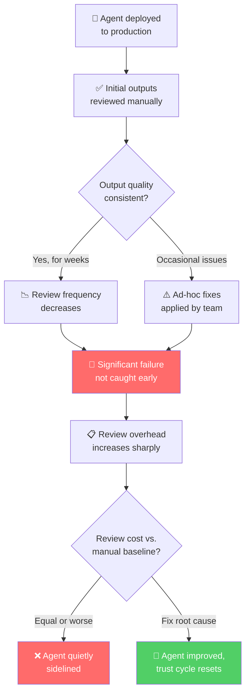

Six months ago, a team we spoke with was running a competitive research agent. Every week it would pull pricing and feature data from competitor sites and drop a formatted summary into their shared workspace.

It worked well for three months. Then one week the pricing table had a number off by about 40%. Not obviously wrong, just plausible enough that the product manager who spotted it had to check three sources before flagging it. They added a review step. Reasonable.

Two months after that, four people were spot-checking the output before it went anywhere. The agent was still running. But the research it produced had become a first draft that two humans needed to verify before anyone trusted it.

At that point the agent wasn't saving time. It was adding latency to a process that had been faster before.

## How Agent Trust Erodes

This is not a rare pattern. It's the default trajectory for agents that don't have systematic quality monitoring.

Trust in an agent doesn't collapse after one bad output. It erodes. Each time a failure happens, the team responds with more review overhead: an extra approval step, a spot-check, a second pair of eyes. These feel like sensible risk management. They are. But they accumulate quietly.

At some point the review overhead equals the cost of doing the task manually. The agent becomes invisible busywork. Someone suggests removing it to simplify the workflow. Because nobody can remember the last time it caught something the team would have missed anyway, it gets sidelined.

The agent didn't fail dramatically. It just became not worth running.

## The Three Failure Modes That Kill Trust Fastest

Not all agent failures erode trust equally.

**Wrong output that looks right.** A research agent that produces a plausible but incorrect answer doesn't get flagged by your error monitoring. It gets flagged by a human who reads it carefully. The longer this goes undetected, the more the team starts assuming every output needs manual verification.

**Inconsistent output quality.** Agents that produce great results 80% of the time and mediocre results 20% of the time are harder to trust than agents that are consistently mediocre. With inconsistent quality, you can't predict which outputs are safe to use without checking. So the team reviews all of them, even when most are fine.

**Failure with no explanation.** When an agent produces wrong output and nobody knows why, the team can't calibrate their response. They don't know if it was a one-time data issue or a systematic problem. The default response is to review everything until it feels safe to loosen oversight. That "until" often never comes.

## What Actually Kills Trust Is Invisible Drift

The failures people talk about are the dramatic ones: the agent that hallucinated a whole report, the one that sent a customer the wrong pricing. Those are memorable. But they're not what kills most agents.

What kills most agents is slow drift. The agent starts out calibrated to the task, produces good outputs, earns reduced oversight. Then something changes: an API endpoint format shifts, an upstream data source restructures, a task prompt gets edited by someone without realizing what it would affect. Output quality degrades. Slowly.

Nobody notices because nobody is measuring output quality systematically. Teams measure completion and uptime. Those stay green. The quality drift accumulates in the background.

By the time a human catches it, the team has already lost confidence. They don't know when the drift started. They don't know how many outputs were affected. And they don't know whether fixing the underlying cause will actually hold.

The result is exactly the pattern described above: manual review overhead climbs, trust drops, the agent gets sidelined or abandoned.

## The Habit That Keeps Trust Intact

If you're running agents in production and haven't defined what "acceptable output quality" looks like in measurable terms, you're operating on informal trust. That works until it doesn't.

The teams that maintain agent trust over time usually do two things most teams skip.

First, they define a quality threshold before the agent goes live, not after the first failure. For a research agent, that might be "less than 5% factual errors on a spot-check of 20 outputs per week." For a report agent, it might be "no more than one flagged correction per month." The specifics matter less than having a number at all. Without a threshold, every failure is evaluated in isolation, which means every failure is surprising.

Second, they treat review overhead as a signal. If the team is spending more time reviewing an agent's outputs now than they were a month ago, something has changed. Either the task has gotten harder, the agent has drifted, or the team's expectations have shifted. None of those are bad in themselves. But all of them need investigation.

[Agent monitoring in AgentCenter](/features/agent-monitoring) surfaces task completion rates, error counts, and cost trends per agent. Tracking review overhead still takes a human habit. But the baseline metrics give you enough signal to know when something has changed, and when it's time to look harder.

If you can see each agent's recent task history from the [agent dashboard](/features/agent-dashboard), you can spot the drift before it becomes expensive to fix.

## Who This Matters Most For

This pattern hits hardest for teams running 4-10 agents where some have been live for several months. The "everything is new" phase is over. You've accumulated informal operational habits. And the team is big enough that a different person might review outputs each week depending on who has bandwidth.

That's where invisible drift lives. No one person sees enough of any single agent's outputs to notice gradual change.

Solo developers who own every agent they run tend to catch this earlier. They're close enough to see when outputs stop looking like they used to. Larger teams with clear named ownership per agent catch it for the same reason. The riskiest setup is the mid-size team where agent ownership is informal: anyone might review any output depending on the week.

If that describes your team, the fix isn't a new monitoring tool. It's naming someone as responsible for each agent's quality, giving them a threshold to watch, and making that threshold visible.

## The Honest Part

No monitoring setup eliminates the need for human judgment on agent outputs. If your agents make decisions with real downstream consequences, some level of review will always be part of the workflow. The goal isn't zero review.

The goal is calibrated review: knowing which agents need more oversight right now, which have earned lighter review, and what number you're watching to make that call. [AgentCenter's deliverable review workflows](/features/agent-monitoring) help make that review structured rather than ad-hoc. But structured review still requires someone who knows what good output looks like for that agent and that task.

Most teams that stop trusting their agents don't do it because the agent was fundamentally broken. They do it because they couldn't tell whether it was broken or not. That's a visibility problem, and visibility problems have a fix.

---

*The dashboard won't fix a broken agent. But it will tell you which one is broken at 3am. [Try AgentCenter free](/pricing).*
