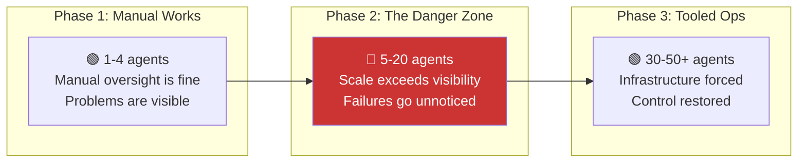

We were running nine agents when things got genuinely hard.

Not one agent failing — nine agents, most of them working, two of them quietly producing bad output nobody caught for three days. The failure wasn't catastrophic. It was invisible. A researcher agent had started including stale data in its summaries. A writer agent downstream accepted those summaries as input and kept going. By the time a human noticed, the problem had already moved through four tasks.

We had more than enough agents to be past "winging it." Not enough to have been forced into structure.

That's the phase most teams don't talk about.

## The Three Phases of Agent Operations

Running agents in production has a curve that surprises nearly every team.

**Phase 1 (1-4 agents):** You know every agent by name. You probably built them yourself. When one fails, you find out quickly — either from a direct error or from a downstream user who noticed. Manual oversight works because the surface area is small.

**Phase 2 (5-20 agents):** You've scaled past what you can watch manually, but you haven't been forced to build the systems that make scale manageable. This is the dangerous zone. Problems are invisible. You find out about failures from users, not from monitoring. Costs start to surprise you at the end of the month.

**Phase 3 (30-50+ agents):** You either built proper infrastructure or you gave up. The teams that survived built dashboards, named owners, runbooks, and structured review. Strangely, 50 agents often feels more controlled than 12 did.

## What Actually Happens at the Middle Phase

The problem at 5-20 agents isn't the number of agents. It's that teams haven't crossed the threshold where operational debt becomes undeniable.

At 3 agents, one failure is 33% of your fleet. It's obvious and painful. You fix it.

At 12 agents, one failure is 8% of your fleet. It's easy to miss — especially if the agent completes its task and returns output that looks fine but isn't. You don't have a review gate because you built the last three agents in a rush.

Specific failure modes that cluster in this phase:

**Silent bad output.** The agent ran. It didn't crash. The output is structurally correct but wrong. Nobody checked because nobody has a clear owner for that agent anymore. The person who built it moved on to building the next one.

**Invisible overlap.** Two agents are running variants of the same job, producing slightly different outputs, and both are feeding into downstream tasks. You only discover this when someone asks why the reports disagree.

**Cost drift.** You have 12 agents and no per-agent cost tracking. Token spend is up 40% this month. You can't tell which agent changed behavior, only that the total is higher.

**Review bottleneck.** When you had 3 agents, one person handled review. Now you have 12 agents and that same person is now a bottleneck. Some deliverables sit for days before anyone looks at them. Others get rubber-stamped.

## What Changes at Scale

Teams that run 40-50 agents with confidence all have the same things in common. Not the same tools — the same habits.

They have a named owner for every agent. Not a team. One person.

They have [monitoring that tracks output quality](/features/agent-monitoring), not just whether the agent ran. Uptime is easy. Knowing whether what it produced was useful is the hard problem.

They have a structured review process. Deliverables don't float in a shared folder — they go through an approval step before going downstream.

They have per-agent cost visibility. Not just total spend. Which agent, which task, which week.

None of this is complicated. All of it gets built when you're forced to — usually after a significant failure at scale. The question is whether you build it at 3 agents or at 25.

## What to Take From This

The chaos of the middle phase isn't inevitable. It's the result of each new agent being added without adding the operational infrastructure to match.

Every team hits this phase. But not every team goes through it. Some teams hit 8 agents, get burned twice, and invest in proper tooling before adding a ninth. Those teams go to 50 agents without the 6-month detour through confusion.

The rule of thumb I'd suggest: before adding the next agent, spend one hour on the current fleet. Check that every agent has an owner. Check that you can see cost per agent. Check that there's a review step before output goes downstream.

That hour is worth more than the next agent.

## Who This Matters Most For

This is most relevant for engineering teams or technical founders who've successfully deployed their first few agents and feel things getting messier as they add more. If you've been attributing that chaos to "agent problems," you might be solving the wrong problem. The agents probably work fine. The operational layer is what's missing.

## The Honest Caveat

More agents doesn't automatically mean better discipline. Plenty of teams run 60 agents in complete chaos — they just have 60 agents worth of chaos instead of 10. Scale alone doesn't force good habits. What I'm describing is the teams that hit scale and built the control plane deliberately, usually after getting burned once. That moment can come at 10 agents just as well as at 50.

---

*The dashboard won't fix a broken agent. But it will tell you which one is broken at 3am. [Try AgentCenter free](/pricing).*
