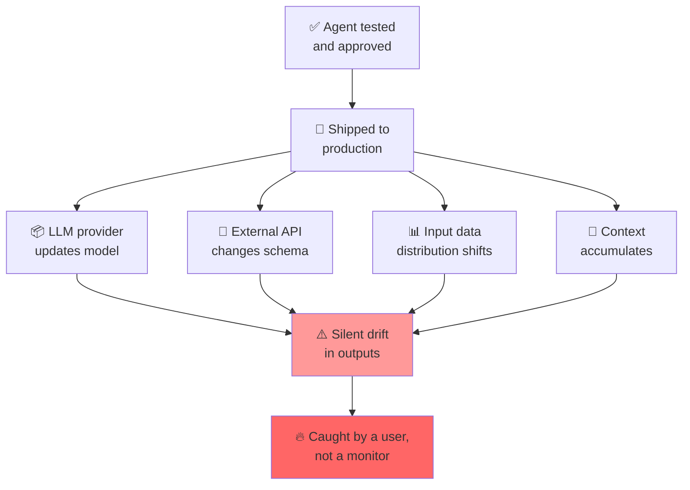

Three weeks after we shipped an agent that extracted key terms from legal documents, a paralegal flagged something odd. The agent was returning different field names for the same document types. Same code. Same prompt. We hadn't touched it since launch.

We spent two hours debugging before finding the cause: the underlying LLM served by our provider had been quietly updated. Not a breaking change. Just a newer version. The output format shifted just enough to break our downstream parsing.

That's the part nobody warns you about. You test the agent. You ship it. You move on. But the agent you're running in week six is not the one you approved in week one.

## What Actually Changes

The obvious thing that changes is your code. You control that. What's harder to see is everything else.

**The model underneath your API call.** If you're calling an LLM through a provider endpoint without pinning to an exact model version, you are not guaranteed to get the same model every time. Providers update models. Sometimes they tell you. Sometimes the update is small enough that they don't bother. The behavior shifts. Your outputs drift.

**The tools and APIs your agent depends on.** Your agent calls an external service to fetch customer data. That team ships a change that adds a new field and renames an existing one. Your agent now reads the wrong field and silently produces wrong answers. Nobody changed a line of your agent's code.

**The data your agent processes.** This is the quiet one. You tested the agent on 100 email samples from last quarter. Now it's processing emails from a new campaign format, a new customer segment, or just a different time of year. The distribution shifted. The edge cases your agent handled well in testing never show up in production. The ones it struggles with show up constantly.

**The context your agent accumulates.** If your agent uses conversation history, a shared memory store, or a growing knowledge base, that context is alive. It grows. It changes. An agent that worked cleanly on a fresh slate can start producing odd output once it's carrying 90 days of accumulated context from production conversations.

## The Problem With One-Time Testing

Most teams test an agent before shipping. They write some examples, run them through, check the outputs, and decide it's ready. That's good. It's necessary. It's not sufficient.

One-time testing answers: "Does this agent work today, on these inputs, with this model version?" It doesn't answer: "Will it still work in 30 days?"

The trap is that the agent keeps running after you've moved on to the next thing. It produces output. Nobody reviews it systematically. The drift happens below the threshold you'd notice unless you were looking for it.

By the time someone catches it, the damage is already done. Three weeks of wrong outputs. Deliverables nobody reviewed. Downstream processes fed bad data.

## What "Still Works" Actually Requires

You need a canary, not just a test suite.

Pick 10 to 20 inputs where you know the exact right output. Not edge cases. Not trick questions. Solid, representative examples where you're confident about what "good" looks like. Run them against your live agent on a schedule. Weekly works. After any external change, run them immediately.

When the outputs change without you changing the agent, something upstream changed. You know within a week instead of within a month.

The [agent monitoring](/features/agent-monitoring) question isn't just "is the agent running?" It's "is the agent still producing what we approved?" Those are different questions. Most teams only monitor the first one.

A few things worth tracking on an ongoing basis:

- **Output format consistency.** If your agent returns structured JSON, does it still return the same fields in the same shape?
- **Error and retry rates.** A meaningful trend upward often signals something changed in the model or an upstream tool.
- **Latency.** A 40% jump in response time is worth investigating even if outputs look fine.
- **Weekly sample review.** Pick five random outputs and read them. You'll catch things no metric will flag.

## Who Gets Burned by This

This hits hardest when the person running the agent isn't the person who built it.

If you inherited an agent, you didn't test it. You took it on faith that it worked. When it drifts, you have no baseline to compare against because you never saw the original.

It also hits teams at the 90-day mark. You shipped in month one, it worked fine in month two, and by month three the inputs have changed enough that the original test cases no longer represent what the agent actually sees. The agent still "passes" your original tests. It just doesn't handle current inputs well.

Teams that catch drift early usually have some form of [ongoing review workflow](/features/agent-monitoring) in place, even a manual one. The teams that find out from user complaints typically have no review at all.

## The Honest Caveat

Even with a canary, you'll miss things. You'll pick test cases that don't cover the new edge cases that emerge. A canary won't catch gradual drift, only sudden changes.

What it does is move the timeline. Instead of finding out in month three when a user complains, you find out in week two when your check flags an unexpected output. That's worth a lot.

A monitoring dashboard won't fix this problem either. Seeing that your agent ran 847 times today tells you nothing about whether those 847 outputs were correct. You still need to define what "correct" looks like and build a way to check for it. The dashboard's job is to make sure that when something does break, you know which agent it is and when it started.

---

*The dashboard won't fix a broken agent. But it will tell you which one is broken at 3am. [Try AgentCenter free](/pricing).*
