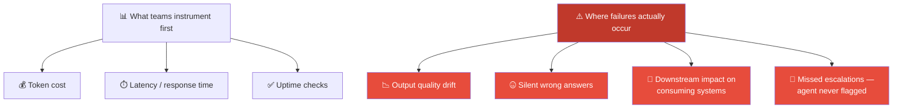

The first metric we added was token spend. Made sense — it shows up on the bill. We added a latency chart too. When agents were slow, we wanted to know. Both dashboards were live on week one. We felt good about our agent monitoring setup.

Six weeks later, one of our 12 production agents had been silently generating inaccurate summaries for the entire document processing pipeline. Token spend: normal. Latency: normal. The agent, by every measure we tracked, was healthy.

The failure wasn't invisible. It was visible somewhere we weren't looking.

## The Problem With Measuring What's Easy First

Token cost and latency are the first things teams instrument because they come straight out of the LLM API response. No extra work required. Add a counter, hook it to a chart, done.

But they measure the mechanics of a call, not the usefulness of what came back.

An agent can complete 1,000 tasks at $0.03 each, with a median latency of 800ms, and still produce wrong output on 30% of them. Your cost dashboard looks great. Your response time chart is green. The problem compounds every hour.

This isn't unique to AI agents. Any new system gets instrumented for what the team fears first. For agents, the first fear is usually the bill and the slowness. Not whether the output is actually correct.

## What Actually Breaks First in Production

Looking back at every agent failure that cost us real time to fix, none of them were caught by cost or latency alerts. Here's where the actual failures came from:

**Output quality drift.** This one takes weeks to surface. The agent is doing its job structurally — it responds, the JSON parses, the task shows complete. But the actual quality has dropped. Summaries become generic. Classifications drift toward one category. You won't see this in a latency chart.

**Silent wrong answers.** Agents don't crash when they're wrong. They produce output confidently regardless of accuracy. If your pipeline treats agent output as ground truth, wrong answers propagate until a human finally notices — often far downstream, far from where the problem started.

**Escalation gaps.** If your agent never flags a task as uncertain or high-risk, that's not confidence. It's the absence of any review trigger. The agent runs 500 tasks, flags zero, costs a reasonable amount, responds quickly. Looks fine on every dashboard you built. But many of those tasks needed a second look.

**Downstream impact.** The agent delivered. The consuming system used the output. Then something went wrong two steps later. Tracing it back takes time you don't have. [Agent monitoring](/features/agent-monitoring) that only covers the agent's own response won't capture this at all.

## What Changed When We Added One Quality Signal

We added a simple output sampling check: 10% of agent outputs reviewed against a set of labeled examples. It wasn't sophisticated. It caught drift within four days of introduction — which means we would have caught our earlier failure in week one, not week six.

One quality signal changed how the whole team thought about the agent. Not "is it running?" but "is it producing useful output?" That's a different question. It leads to different conversations, different alerts, and a different definition of done.

The [agent task workflow](/features/task-orchestration) changed too. Instead of treating agent tasks as complete when the agent responded, we started treating them as complete when a reviewer confirmed the output was acceptable. Not for every task — sampling is enough for most use cases. But for the tasks with the highest downstream impact, completion means quality check passed, not just response received.

## Three Signals You Need Before Shipping

We now instrument three things before any agent goes to production:

1. **One reliability signal** — is the agent responding at all? Uptime and latency cover this.
2. **One cost signal** — how much does this agent cost per task, and is that stable over time?
3. **One quality signal** — is the output actually useful, not just structurally valid?

The third one is the hardest to define and the easiest to skip. Skipping it means you'll find out about quality failures the hard way: from a downstream team, from a broken pipeline, or from a stakeholder asking why the reports stopped making sense last month.

A rough proxy is better than nothing. A downstream metric that correlates with good output. A sampling rate paired with a manual review checklist. Even a simple "flag for human review" rule that triggers when the agent's output length drops below a threshold. Start there.

## Who This Hits Hardest

Teams that have had one or two reliability incidents but no quality incident yet.

Reliability incidents are visible and urgent. They get resolved fast and build confidence in your monitoring. After you've survived a couple of them, it's easy to feel like you have solid coverage.

You probably don't have coverage where it counts. A quality incident is gradual and quiet. The same monitoring setup that catches latency spikes won't catch output drift. The same alert that fires when an agent goes offline won't fire when the agent is producing subtly wrong answers on a Tuesday afternoon.

If you've been running agents for a few months and haven't hit a quality failure yet, it's worth asking: is that because your agents are actually that good, or because you wouldn't know if they weren't?

## Honest Caveat

Setting up quality signals is genuinely hard. You need examples of good and bad output. You need someone to own the review process. You need to define what "correct" means for each agent — and that's not always obvious.

This isn't an argument for waiting until your monitoring is perfect before you ship. It's an argument for not treating "token cost is normal, latency is fine" as evidence that everything is working.

Those metrics tell you the agent showed up. They don't tell you whether it did anything useful.

---

*The dashboard won't fix a broken agent. But it will tell you which one is broken at 3am. [Try AgentCenter free](/pricing).*
