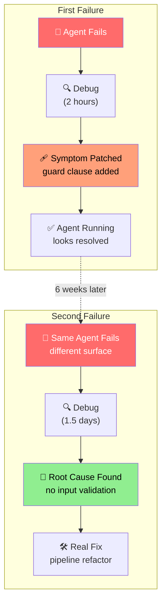

A data extraction agent hit an edge case on a Tuesday morning. Malformed HTML in one out of every 80 inputs was causing the parser to fail silently. The team found it within an hour, added a guard clause, reran the 11 failed tasks, and shipped the fix by mid-afternoon. Two hours total. Clean.

Six weeks later, the same agent failed. That one took a day and a half.

## The First Failure Is Never the Real One

Here is what happened the second time: the guard clause handled malformed HTML fine. But the root issue was that the agent was never validating input format before starting work. Malformed HTML was just one way that showed up. When a new data source came online with a different encoding problem, the agent failed again — in a different spot, for the same underlying reason.

The team had not fixed the agent. They had fixed one symptom.

The second failure took longer for a few reasons that compound on each other.

**Trust shifted.** The team assumed the first fix held. When the alert fired again, the first reaction was "this can't be the same thing." That assumption costs time. People look in the wrong places first.

**Context was lost.** The engineer who fixed the first failure was out of office. The notes from the original debug session were thin — "added HTML guard, resolved." Starting fresh from thin notes is slower than continuing from where you left off.

**The fix scope grew.** Once the real root cause surfaced, a second patch was not enough. Input validation had to be retrofitted across multiple points in the pipeline. Work that should have been done the first time now required rearchitecting part of the flow.

**Stakeholder patience dropped.** The first failure was an unexpected edge case. The second failure was "why did this happen again?" Those are different conversations.

## Why Teams Patch Symptoms

Nobody does this on purpose. When an agent fails in production, there is pressure to restore it fast. You find what caused this specific failure, fix it, move on. That is rational under time pressure.

The problem is that agents are not one-off scripts. They run continuously, against varied inputs, often touching systems you do not fully control. A symptom fix restores operation today. It does not address why the agent is fragile in that area.

The specific failure you patched is the one your agent will not fail on again. But the underlying brittleness will find another way out.

## How to Tell If You Are Patching a Symptom

After fixing a failing agent, write down the answer to: "What class of inputs or conditions would cause a similar failure?"

If you cannot answer that, you likely fixed the symptom.

A root-cause fix answers it clearly: "Any input that bypasses schema validation" or "Any state where task context exceeds 80k tokens" or "Any external API call that returns 429 without a retry header." Those are fixable categories. A symptom fix only addresses the one example that surfaced.

[AgentCenter's agent monitoring](/features/agent-monitoring) captures the input context and task state at time of failure — not just the error message. That gap matters. You need to see what the agent received, not just that it crashed.

## What the Second Failure Actually Costs

The extra debugging hours are the visible cost. The invisible costs take longer to show up.

It costs confidence. If your agents fail twice in the same area, engineers start wondering what else is held together loosely. That skepticism slows down the next deployment and the one after.

It costs your stakeholder relationship. If the agent touches customer data or downstream workflows, a repeat failure is harder to explain than a first one. "We patched it" holds. "We patched it and it happened again" requires a longer conversation and sometimes a review.

It costs trust in your observability. If the monitoring did not surface the fragility the first time, teams start questioning what else it is missing. That doubt is hard to undo.

## Who Feels This Most

Teams with more than four or five agents running in production hit this pattern regularly. There is enough velocity that quick patches feel like the right move — and enough complexity that root causes get lost between sprints.

Solo founders running a small fleet often skip root cause analysis entirely on the first failure. The second failure is where things start to feel unstable. If you fixed the same agent twice, do the analysis now, before a third failure. It will not feel urgent. Do it anyway.

The teams that handle this well keep brief postmortem notes that answer two questions: what broke, and what class of condition would cause the same failure somewhere else? Two sentences. Done in 20 minutes. Catches the next one before it ships.

## The Honest Caveat

Not every failure needs a deep investigation. A retry bug with a clear cause is a retry bug. Fix it and move on.

The pattern that bites teams is the failure with ambiguity in the cause. If your first debug session included the phrase "I think it was because of X," you are probably patching a symptom. Spend another hour confirming before you close the ticket.

[See pricing](/pricing) if you want a dashboard that makes agent failures easier to investigate the first time — so you are not tracing through logs six weeks later trying to remember what happened.

---

*The dashboard won't fix a broken agent. But it will tell you which one is broken at 3am. [Try AgentCenter free](/pricing).*
