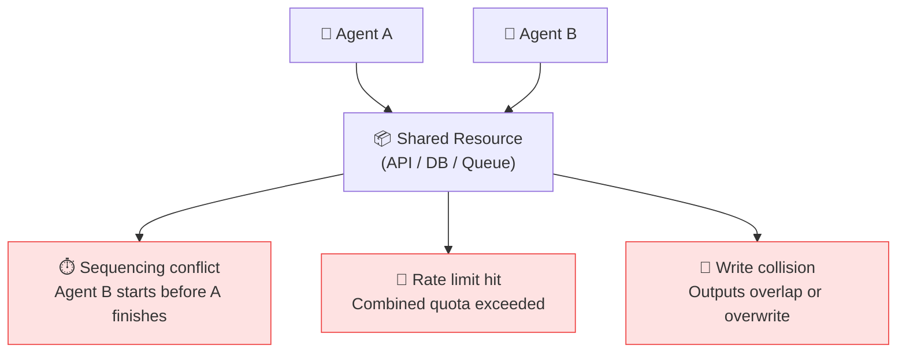

You deploy your first agent on a Thursday afternoon. It works. It pulls data, formats a summary, posts it somewhere. You watch it run for a week. No surprises.

Then you deploy the second one. Same setup, same stack, roughly the same task type. Within three days, you're debugging something you genuinely don't understand — and the problem isn't in either agent individually.

That's the pattern. Not everyone hits it at agent two. Some teams make it to five or six before things start wobbling. But almost every team eventually runs into a wall that has nothing to do with model quality or prompt design, and everything to do with coordination.

## One Agent Is a Process. Two Agents Is a System.

That distinction matters more than it sounds. A single agent has one failure surface: the agent itself. You can trace what it did, check its inputs and outputs, and figure out what went wrong.

When you add a second agent, you get a third failure surface: between them. Timing, context passing, shared state, sequencing assumptions you never wrote down — all of it becomes load-bearing infrastructure the moment two agents touch the same environment.

Your agents might not even know about each other. But they share a task queue, or a database, or an API with rate limits, or a downstream system that assumes one writer at a time. Suddenly you have dependencies you never planned for.

## The Three Coordination Failures That Actually Happen

After watching teams grow from one to many agents, the same failure modes show up over and over.

**Sequencing assumptions.** Agent B is supposed to run after Agent A finishes — and that holds 90% of the time. The other 10%, Agent A runs long because the upstream API is slow, and Agent B starts on incomplete data. Neither agent throws an error. The output just looks off, and you only notice three days later when a downstream system complains.

**Shared resource collisions.** Both agents write to the same output bucket, the same Notion database, the same Slack channel. When they run in separate windows it's fine. When they overlap briefly, you get garbled output that neither agent produced on its own. Debugging it feels absurd because both agents ran correctly.

**Invisible rate limits.** Agent A alone uses 40% of your API quota. Agent B alone uses another 40%. Together they're fine in off-peak hours but hit the limit every morning at 9am when both kick off simultaneously. Each agent logs success. The API provider logs a 429. You find out from a user.

These aren't exotic edge cases. They're the default behavior when two agents share infrastructure and no one explicitly planned for it.

## Why Your First Agent Doesn't Prepare You

Your first agent probably worked well. You tested it, watched it, tuned it. When it broke, you fixed it. That whole loop was tractable — one thing doing one thing.

That success creates a mental model: agents are basically automated scripts with better reasoning. And in isolation, that's roughly true. But once you have two, that model stops predicting what will break.

Scripts usually don't share state. They don't coordinate. They don't have to care what else is running at the same time. Agents in production often do — and it's easy to miss that because each individual agent looks fine.

## What to Answer Before Deploying Agent Two

One specific question to work through before you ship the second agent: *what does this agent share with the ones already running?*

Go through the list: shared APIs, shared databases, shared output destinations, shared timing windows, shared downstream systems. For each, ask what happens if both agents touch it at the same time.

This doesn't take long — maybe 30 minutes for a simple setup. But almost no one does it. They copy the deployment pattern from agent one, adjust the prompt, and ship. That works until the two agents' worlds collide.

For teams with [real-time visibility into agent status](/features/agent-monitoring) — which agent is running, what it's doing, how long it's been blocked — the collision at least becomes visible quickly. Without that, you're piecing together what happened from two separate logs that each tell a coherent but incomplete story.

## The Jump from Two to Ten Is Not Linear

Going from one agent to two is a bigger jump than it looks. Going from two to four is bigger still. By the time you have ten agents, the number of potential pairwise interactions is 45. You can't hold that in your head.

Teams that scale past this without burning down do a few things differently. They treat each new agent like new infrastructure, not a copy-paste job. They map dependencies before deploying, not after something breaks. And they use a shared view across agents — a single place to see what's running, what's blocked, and what's consuming shared resources.

That shared view doesn't have to be complicated. A [Kanban board for agent tasks](/features/task-orchestration) with real-time status is enough to catch most coordination problems early. The goal isn't a perfect coordination framework. It's being able to answer "why are these two agents behaving oddly right now?" without reading 40 minutes of interleaved logs.

## Who Feels This Most

Solo developers who built one agent that worked great are the most likely to be surprised by agent two. The confidence from the first one is real, and the failure modes are genuinely different.

Growing teams — three engineers, six agents, no formal ops practice — hit it next. Usually when they're trying to debug something and realize they can't tell which agent did what, in what order, touching which shared resource.

The pattern mostly breaks for teams that answer the "what does this share?" question before shipping. Not because they have a more sophisticated setup — often they have a simpler one — but because they designed for coordination from day one instead of after the fact.

## The Honest Caveat

More visibility doesn't automatically prevent coordination failures. Two agents sharing a rate-limited API will still hit that limit whether or not you can see it happening. The benefit of [agent monitoring](/features/agent-monitoring) is faster diagnosis, not prevention.

You still have to design agents that coordinate well. Visibility just makes the design gaps obvious sooner — before they become late-night incidents that take you four hours to trace.

Adding agents is easy. Managing what they share is the work.

---

*The dashboard won't fix a broken agent. But it will tell you which one is broken at 3am. [Try AgentCenter free](/pricing).*
