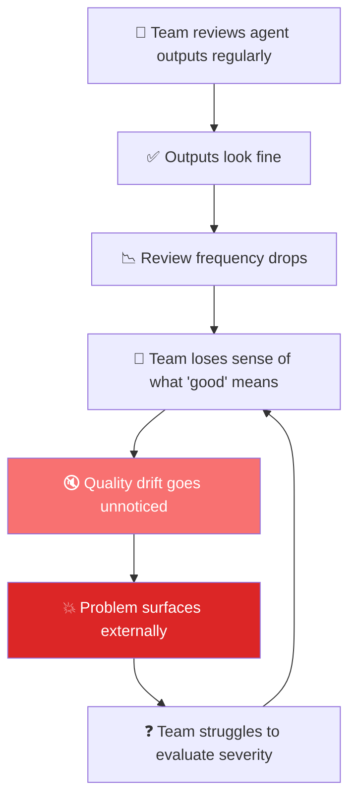

We had 12 agents running. All of them were unreviewed for the better part of a quarter. Not out of neglect exactly — we had dashboards, we had uptime metrics, and outputs had been consistently fine for months. So review frequency dropped from weekly to monthly, then stopped entirely somewhere around month four.

Six weeks before we caught it, a summarization agent had started dropping context from inputs longer than 8,000 tokens. The truncated summaries looked plausible. Automated checks passed. Nobody noticed because nobody was reading them. A customer flagged it when a summary missed critical contract terms.

The agent hadn't crashed. No alert fired. The only thing that failed was the team's ability to catch a subtle, gradual problem.

## What Actually Degraded

Here's the uncomfortable part: the agent did what agents do. Behavior drifted slightly as upstream inputs changed, and the drift was subtle enough that metrics didn't catch it.

The problem was that nobody on the team knew what a good summary looked like anymore. We hadn't read outputs in months. The institutional knowledge of what the agent was supposed to produce had quietly disappeared.

When we tried to debug, we found three things:
- Nobody could articulate the quality bar for a correct summary
- The only person who understood the original prompt's intent had left three months earlier
- We had no sample of known-good outputs to compare against

This is the real cost of unreviewed agents: not just missed errors, but lost calibration.

## The Feedback Loop That Breaks Down

This loop is what makes the problem self-reinforcing. You review outputs. Outputs look fine. Review less. But "looking fine" and "being good" are different when you're the one maintaining the standard. As review frequency drops, the standard drifts down with it. You forget what edge cases to watch. New team members never learn them.

By the time something surfaces externally, the team genuinely cannot evaluate how bad it is. Was this the first week of bad outputs? The sixth? Nobody knows because nobody was looking.

## What You Actually Lose

The review habit is only the surface layer. What erodes underneath it is harder to rebuild.

**Product knowledge.** The person who designed the agent understood why certain outputs mattered and what "correct" looked like in context. That knowledge does not transfer automatically. It lives in heads until it doesn't.

**Edge case awareness.** Every agent has inputs that are harder than average. Teams discover these over time and watch for them. When review stops, you stop discovering new edge cases and you forget the ones you already knew.

**Calibration.** When outputs look roughly right to someone who hasn't read them in 90 days, "roughly right" is carrying a lot of weight. The ability to distinguish subtle errors from acceptable variation requires active practice. It atrophies when nobody practices.

A team that reviews agent outputs weekly can usually catch a problem within days. The same team, four months later with no review habit, might not catch the same problem for weeks.

## Who Notices First

It is rarely the engineering team. More often it's:

- A customer or downstream user who sees the output directly
- An audit that flags inconsistencies across a batch of outputs
- A new hire who hasn't developed the learned habituation to what "good enough" looks like

Each of those surfaces problems later and at higher cost than internal review would have. Customers lose trust. Audits consume time. A new hire's report can feel like an indictment of the whole team's processes.

## Who This Hits Hardest

Teams six to eighteen months into agent operations are most exposed. You're past the initial scrutiny phase when everything was new and everyone was watching. Your agents have track records. Track records read as trust. But track records don't protect against drift — they just make drift less visible.

Growing teams hit this too when new members inherit agents they trust because the original team trusted them, without the context for why that trust was earned. The calibration doesn't come with the handoff.

## What to Do About It

**Sample outputs on a schedule.** Even if your agents run 500 tasks a week, reviewing 10 to 20 outputs per agent per week keeps the team calibrated. The goal is not to catch every error — it's to maintain the human sense of what good means.

**Keep a golden set.** Pick 20 examples of known-good outputs and review them once a quarter. If current outputs don't match the standard your golden set represents, you have drift.

**Build review into onboarding.** Every new team member should spend time reading agent outputs before they change anything. This transfers product knowledge and sets calibration. It takes a few hours. It saves weeks later.

**Document the quality bar.** Not just the prompt. The expected output characteristics. What are you watching for? What variation is acceptable? What counts as a flag? Write it down.

You can use [agent monitoring features](/features/agent-monitoring) to track error rates and performance, and [approval workflows](/features/task-orchestration) to require human sign-off before outputs go live. Both help. But neither replaces the practice of reading outputs and maintaining a live sense of what good looks like.

## The Honest Caveat

AgentCenter will not prevent judgment atrophy if the team never reviews outputs. Tooling can surface metrics, flag anomalies, and route outputs for review. It cannot substitute for a team that actively stays calibrated to what their agents produce.

Agents that work well for months are easy to trust. That trust is the risk. The agents that have been running fine for the longest are the ones nobody thinks to check. That is exactly when checking matters most.

---

*The dashboard won't fix a broken agent. But it will tell you which one is broken at 3am. [Try AgentCenter free](/pricing).*
