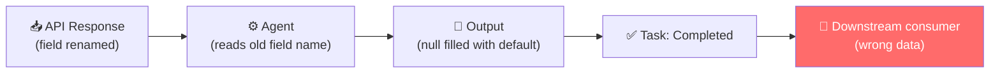

We had a report-generation agent running for three weeks. Wrong agent output the entire time — but no one knew. Green status. No errors. No timeouts. No retries. The agent was consuming tokens, completing tasks, and moving on.

Then a stakeholder read one of the reports.

The data was off. Not obviously wrong — subtly wrong. Numbers skewed by a factor of three. Analysis referencing the right metrics but applied to the wrong time window. It had been happening for at least 11 days before anyone noticed.

That's the thing about wrong output. It doesn't look like a failure.

## When Completion Doesn't Mean Correct

When an agent crashes, you know immediately. The task stays open. The status goes red. The failure is visible, so it gets fixed.

Wrong output doesn't trigger any of that. The task completes. The status turns green. No one gets paged. The deliverable moves downstream and gets consumed. The problem compounds silently until a human reads it and notices something is off.

This is the failure mode that production monitoring almost never catches by default, because most monitoring tools are built around a binary question: did the agent complete, or didn't it?

That question misses an entire category of production failure.

## Three Places Wrong Output Comes From

There are three common origins for plausible-but-incorrect agent output. None of them crash the agent.

**Schema drift in the data the agent reads.** An agent pulling data from an API starts receiving a renamed field. The agent doesn't crash — it just returns null for the field it can't find and fills in defaults. The output looks complete. The numbers are garbage.

**Prompt drift.** A prompt was written when the system had 6 agents and 2 projects. Now it has 40 agents and 18 projects. The instructions that made sense in the original context no longer hold. The agent still runs cleanly — it's just operating on outdated assumptions about what it should produce.

**Downstream context contamination.** In a multi-agent pipeline, Agent A passes output to Agent B. Agent A starts producing slightly off results. Agent B treats them as ground truth. By the time a human sees the final output, the error is several hops removed from its source and looks nothing like the original problem.

This last one is the hardest to debug. You trace the wrong output back through three agents, and none of them show an error. The [multi-agent workflow](/features/agent-monitoring) ran exactly as designed. The design was just working with bad inputs.

## Completing a Task Is Not the Same as Completing It Correctly

That sentence sounds obvious. In practice, most teams don't build their monitoring around it.

If your monitoring treats "completed" as "correct," you're flying blind for an entire class of failures. You need at least one check that evaluates output quality, not just output presence.

In practice, that means four habits:

**Review samples.** Pick a small percentage of agent outputs — even 5% — and have a human or a review agent check them against expectations. Not all outputs, just enough to catch systematic problems early.

**Set output shape checks.** If an agent is supposed to return a number between 0 and 100, add a validation check for that range. Not as a crashguard — as a quality signal. If values start hitting 0 or 100 suspiciously often, something changed upstream.

**Track output variation over time.** If an agent's outputs suddenly cluster in a narrow range when they used to vary widely, that's worth investigating even if the agent is technically completing every task. Stability in a variable system usually means something stopped changing that should still be changing.

**Baseline comparison.** Run the agent against a fixed input with a known expected output on a schedule. Compare the result. If it drifts, you know something changed — the model, the context, the upstream data, or the prompt.

AgentCenter's [deliverable review workflow](/features/agent-monitoring) is built specifically for this. You can route specific task types through a review gate before their outputs move downstream, and the activity feed surfaces output pattern shifts across the fleet. It won't automatically tell you if an analysis is factually correct, but it gives you a structured place to catch problems before they compound across 11 days of reports.

## Who Hits This Hardest

If you're running agents that produce outputs a human eventually reads or acts on — reports, summaries, data extracts, draft content, analysis — this failure mode is more likely than a crash. Crashes are obvious. Output quality problems are not.

It's less critical for agents that execute actions: sending emails, updating records, triggering builds. Those fail differently. The action either happened or it didn't, and both states are usually detectable.

For output-producing agents in production, the mental model shift is: treat every green status as "completed," not as "correct." Those are different things, and your monitoring should reflect that.

## The Honest Part

Catching wrong output is genuinely hard. There's no monitoring setup that automatically validates whether an agent's analysis is factually accurate. You still need humans reviewing anything where quality actually matters.

What you can do is cut down the time-to-detection. For most teams right now, that's measured in days or weeks. With sampling and shape checks, you can get it down to hours. That's not a solved problem — it's just a much smaller one.

The goal isn't zero wrong outputs. It's catching them before they compound.

---

*The dashboard won't fix a broken agent. But it will tell you which one is broken at 3am. [Try AgentCenter free](/pricing).*
