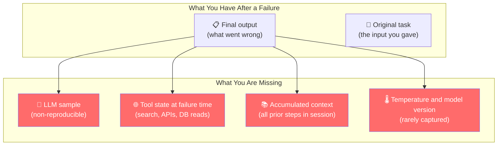

You get a Slack message at 10am. A customer says your research agent produced three sentences of complete nonsense in the middle of an otherwise solid summary. You have the output. You have the task that triggered it. You run the agent again with the same input.

It works fine.

You run it fifteen more times. Still fine. You show the failing output to two colleagues. One says "huh" and the other says "model glitch." You close the ticket and mark it resolved.

Two weeks later, it happens again. Different customer, different task, same pattern. You still can't reproduce it.

## The State That Caused Your Agent's Failure No Longer Exists

When code fails, the bug is in the code. Run it again with the same inputs and you get the same failure. You add logs, trace the state, find the cause. Deterministic by design.

AI agents don't work that way. Three things make most agent failures impossible to reproduce:

**LLM sampling is non-deterministic.** The output you got during the failure was one sample drawn from a probability distribution. The model won't draw that same sample twice. Even with temperature set to 0, different infrastructure, cache state, and batching across API providers can shift results.

**External tool state changes.** If your agent called a search API, a database, or a third-party service during the failure, that state is gone. News results from two hours ago are different now. A database row that got updated is no longer what the agent saw. You can't go back.

**In-context state accumulates.** Long-running agents build up context over many steps. The specific combination of tool outputs, intermediate reasoning, and prior conversation that existed at the moment of failure is unique to that run. You can't recreate it.

When a failure happens, you have the output and the original input. Everything in between -- the model's sampling path, the tool responses, the accumulated context -- is gone unless you captured it before the incident.

## Three Patterns This Creates in Production

**The rare-but-real failure that becomes chronic.** A summarization agent runs 40 documents per batch. It fails on document 23 once, then completes fine on retry. Nobody captures what happened at step 23. Three months later, the same pattern appears more frequently as volume grows. You still have no diagnostic data.

**The external dependency failure you mistake for a model problem.** A research agent pulls stale pricing data from a third-party API during a brief cache issue. Its output is confidently wrong. You investigate the model. The API was the actual cause -- but by the time you look, the cache is warm and the API returns correct data. You close the ticket with "model issue, unresolved."

**The multi-step failure you can only see in aggregate.** In a pipeline where three agents hand off work sequentially, agent 3 fails because of an unusual output from agent 1. You can reproduce the original task. You cannot reproduce the specific output path from agent 1 that led to agent 3's failure. The pipeline runs clean every time you test it.

## What to Capture Before the Next Failure

You can't prevent non-deterministic failures. You can design your agents to leave evidence.

At each step, capture:
- The full prompt sent to the model, including any injected context or tool output
- Every tool call: exact inputs and exact responses
- A timestamp and trace ID per step
- The model name, version, and temperature in use

This isn't optional if you want to do real post-mortems. Without it, you're analyzing the output without the state that produced it.

AgentCenter's [agent monitoring](/features/agent-monitoring) tracks per-task execution history -- which steps ran, in what order, and what each step received and returned. It gives you enough context to reconstruct what the agent was working with when something went wrong, without needing to rebuild the full non-deterministic state.

If you're building this capture layer yourself, design it before the agent goes live. Retrofitting it into a running agent is harder than it sounds -- and you'll always add it one failure too late.

## How This Changes the Way You Write Agents

If failures can't be reproduced, the focus shifts from debugging to prevention and early detection.

In practice that means:
- Set tight output format requirements so deviation is caught immediately, not a week later
- Validate outputs at each pipeline boundary, not just at the end
- Sample real production outputs regularly -- don't wait for a customer to report a bad one
- Alert on schema violations and unusual retry rates as early warning signals

[Approval workflows](/features/task-orchestration) let you add a human review gate before outputs move downstream. For high-stakes or low-volume tasks, that gate catches what automated validation misses.

## Who This Matters Most For

Engineers who've just shipped their first or second production agent and are seeing failures they can't reproduce. The instinct is to try harder to recreate the failure. The better move is to build capture infrastructure before the next failure happens.

Teams that already have observability in place know this. The ones who don't are usually learning it from a failure they couldn't explain to anyone -- including themselves.

## The Honest Caveat

Some agent failures are fully reproducible. Bad input data, broken tool configurations, misconfigured credentials, logic errors in your orchestration code -- these are deterministic. Run the same task and you get the same failure. Find them and fix them.

The non-reproducible ones are model-output failures and external state failures. For those, captured state is the only evidence you'll have.

The tricky part: you often don't know which kind you're dealing with until you've tried. If you've run the same task 20 times and it always works, you're probably looking at a non-deterministic failure. That's when logs of the original run are the difference between a five-minute diagnosis and a two-week investigation that goes nowhere.

---

*The dashboard won't fix a broken agent. But it will tell you which one is broken at 3am. [Try AgentCenter free](/pricing).*
