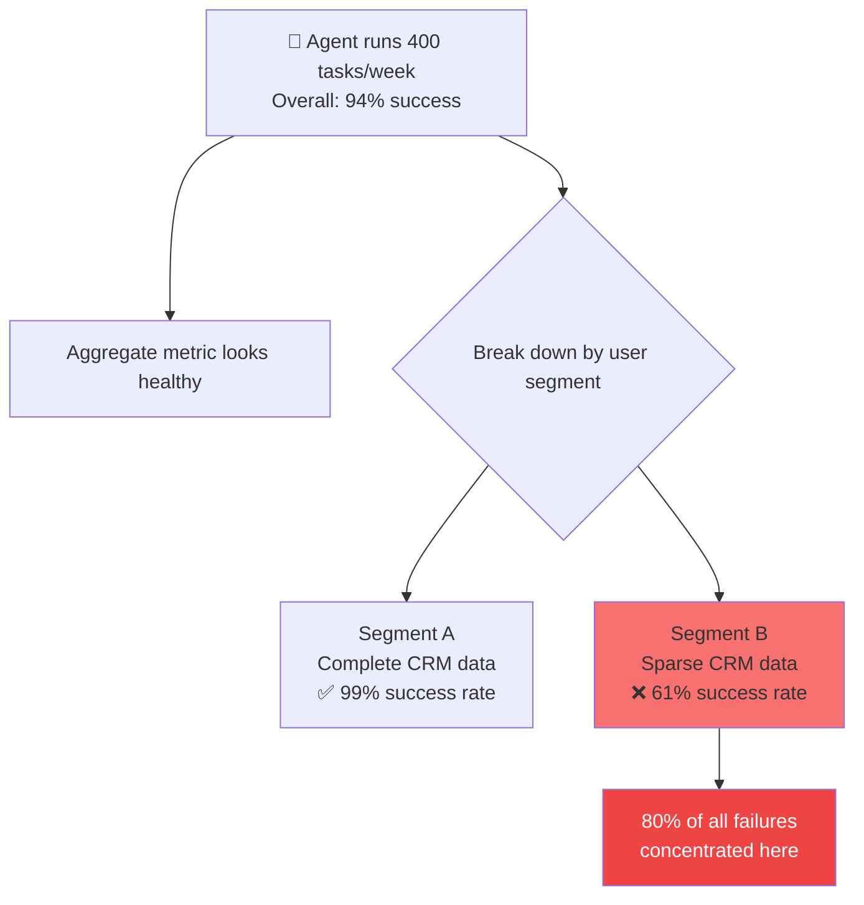

We had an AI agent handling document summaries. It pulled context from customer CRM records and produced structured summaries for account managers before their calls. Ran 400 tasks a week. Task completion rate: 94%. Our team was satisfied.

Then one of our enterprise customers complained that the agent "almost never works" for their team.

That didn't match our numbers. The dashboard showed healthy metrics. But when we pulled the raw task log and filtered by that customer's records, the completion rate was 61%. Not 94%. 61%.

The problem wasn't the agent. The problem was that we had been watching the wrong number.

## Aggregate Success Rates Hide Per-User Failure Patterns

When your agent has a 94% completion rate, that 6% isn't distributed randomly across users. It's usually concentrated. Heavily.

In our case, 80% of the failures came from customers whose CRM records were missing three or more required fields. The agent would try to build a summary, find gaps in the data, return an incomplete output, and get flagged as failed. The other customers, with cleaner data, had a 99% success rate.

From the outside, both groups looked the same. The agent ran for everyone. It just produced bad outputs for one group and good outputs for the other.

Most monitoring doesn't show this because it aggregates everything together. One dashboard. One number. One status: healthy.

## Why This Happens in Production

Three factors create per-user failure patterns in AI agents:

**Data quality differences.** Some users have clean, complete records. Others have sparse, outdated, or inconsistently formatted data. Your agent was likely tested with the clean version. It handles the messy version worse.

**Request complexity differences.** Different users ask different things. A simple request with a clear scope is easy. A vague, multi-part request with conflicting constraints is harder. Some users always send the simple version. Others don't.

**Context completeness.** Some users fill in all the required fields before triggering a task. Others trigger the agent with half the information it needs. The agent gets different context every time, but you see one aggregated success rate.

The 94% number is technically accurate. It's also useless for finding the problem.

## What You Actually Need to Monitor

When we started breaking down the failure rate by customer segment, three things became clear fast.

First, the pattern appeared within the first 50 tasks. We didn't need weeks of data. One day of segmented metrics would have told us the same story.

Second, the fix was upstream of the agent. The agent didn't need to change. The CRM data did. Or, at minimum, we needed a validation step that caught incomplete records before they reached the agent.

Third, the affected users had already stopped trusting the feature. They had mentally categorized the agent as unreliable before we even knew there was a segment-level problem.

That last one is the real cost. Once a specific team decides your agent doesn't work for them, recovery is slow. You fix the problem; they don't believe the fix worked. They keep manually checking outputs. The time savings you built the agent for evaporate.

## Where to Start Looking

If you don't know whether your agent fails equally across users, you probably don't — and the answer is probably no.

Start by pulling raw task outcomes and grouping them by two dimensions: who triggered the task (individual user, team, customer tier) and what input they provided (length, completeness, whether required fields were present).

You don't need sophisticated analysis. A simple breakdown showing completion rate by customer or by input type usually reveals the pattern inside 30 minutes.

If you have [agent monitoring](/features/agent-monitoring) set up, filter the task view by user segment and compare completion rates. Look for anything below your overall average by more than 15 percentage points. That's your starting point.

## Who This Hits Hardest

Teams building agents that serve multiple customers or user groups are most exposed. Internal agents — where everyone has the same data quality and similar request patterns — show less of this problem.

But the moment your agent touches customers, CRM data that varies by account, requests that differ by team, inputs that depend on each user's workflow, you have a failure distribution problem, not just a failure rate problem.

This is also a trust problem. The enterprise customer who sees 61% success doesn't care that your aggregate number is 94%. Their experience shapes whether they renew, escalate, or stop using the feature.

## The Honest Caveat

Seeing individual task outcomes in [a monitoring dashboard](/features/agent-monitoring) is necessary but not sufficient. You can filter by project or agent and spot concentration — but clustering failures by user attribute or input shape still takes a manual step. You need to pull the data and look.

Automated segment-level alerting is something most monitoring tooling doesn't do out of the box. The workaround is a weekly habit: break your failure rate down by who is failing, not just how many.

It takes 20 minutes. It changes what you find.

---

*The dashboard won't fix a broken agent. But it will tell you which one is broken at 3am. [Try AgentCenter free](/pricing).*
