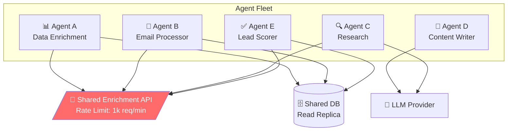

Three weeks after we hit 12 agents in production, everything looked healthy. Uptime was solid. Error rates sat below 1%. Tasks were completing on schedule.

Then on a Tuesday morning, 11 of the 12 agents went silent within four minutes of each other.

They didn't crash. No errors showed up in the logs. They just stopped returning useful output. The 12th agent kept working fine. It was the only one that didn't call a shared third-party enrichment API we'd been using since month one.

No one had written down which agents used that API. It hadn't seemed necessary at the time.

## The Dependency Graph Nobody Drew

When you add your first agent, you wire it up to whatever it needs and keep moving. Second agent, same thing. By the time you have 12, you've got a web of shared resources that nobody mapped because each individual connection seemed obvious when it was made.

Shared API credentials. A single database read replica. One LLM provider. A common file storage bucket. A queue worker that two agents both write to.

Any one of these can take down more than just the agent using it. When the dependency hits a rate limit or goes offline, every agent connected to it stops. And if you haven't drawn the map, you won't know that until you're staring at a wall of silent tasks trying to figure out why half your fleet just went idle.

Four agents all sharing the same rate-limited API. When that API goes down or hits its limit, four failures show up in your dashboard at once. The fifth agent, which only uses the LLM, keeps running fine. If you're scanning a flat list of task statuses, that pattern is hard to read.

## Three Ways This Shows Up in Production

**Rate limits cascading.** One agent runs a batch job at 2am and burns through your daily API quota. When the rest of the fleet starts up at 7am, they all hit 429 errors. Individually, each failure looks like a transient API error. Together, they're one root cause with five instances.

**Shared credentials expiring.** An API key rotates, or a service account loses a permission. The first agent to fail gives you a clear error. But if eight agents use the same key and you haven't mapped that, you might spend time debugging three separate failure threads before realizing it's one expired credential.

**Provider partial outages.** If most of your agents route through one LLM provider, a 10-minute partial outage turns into 30 stuck tasks. You don't get one thing to debug — you get 30 timestamps showing tasks that started and never finished.

## What the Map Actually Looks Like

You don't need a formal architecture diagram. A spreadsheet works. One row per agent, columns for: which external APIs it calls, which credentials it uses, which database or storage it reads from, which queues it writes to.

Once you have it, you can answer three questions in under a minute:

- Which shared resource, if it went down, would affect the most agents?
- Do any agents share credentials with a single expiry date?
- If your LLM provider had a partial outage, which agents would go silent vs. which would fail loudly?

That last distinction matters. Silent agents are worse than crashing ones. A crash shows up as an error you can respond to. A silent queue just looks like nothing happened. You might not notice for hours if you're not watching the right signals.

The [agent monitoring dashboard](/features/agent-monitoring) in AgentCenter shows real-time status across your whole fleet. When multiple agents go idle at the same time, that pattern is a strong signal of a shared dependency problem, not individual agent bugs. Seeing five agents flip to idle within a two-minute window is different from five agents failing one at a time over an hour.

## What to Do Before You Have 10 Agents

Draw the dependency map now, before you need it at 2am.

Go through each agent and list every external thing it calls. Then look for overlap. Three agents using the same credentials is a single point of failure. Five agents calling the same API means a rate limit affects all five.

For the highest-risk shared resources, think about fallbacks. A second API key. Multiple LLM providers. A read replica with automatic failover. You can't make everything redundant, but you can protect the resources that would take down the most agents.

Set up monitoring that fires when multiple agents go idle within a short window. That pattern — several agents going quiet in parallel — almost always means a shared dependency, not coincidence. You can see this clearly from the [agent dashboard](/features/agent-dashboard) once you know what to look for.

## Who This Matters Most For

Teams that added agents incrementally over several months. Each agent made sense in isolation. No one stopped to draw the full picture.

If you've got more than 5 agents running in production and you can't quickly name every shared resource between them, you have a map to draw. The good news is that drawing it usually takes less than an hour and shows you the problem immediately.

## One Thing to Be Honest About

Having the map won't prevent failures. Your shared API will still hit its rate limit. Providers will still have incidents. What the map changes is how fast you find the root cause — 2 minutes instead of 40, because you already know which dependency connects which agents.

The teams that debug fastest aren't the ones with the most alerts. They're the ones who drew the map before they needed it.

---

*The dashboard won't fix a broken agent. But it will tell you which one is broken at 3am. [Try AgentCenter free](/pricing).*
