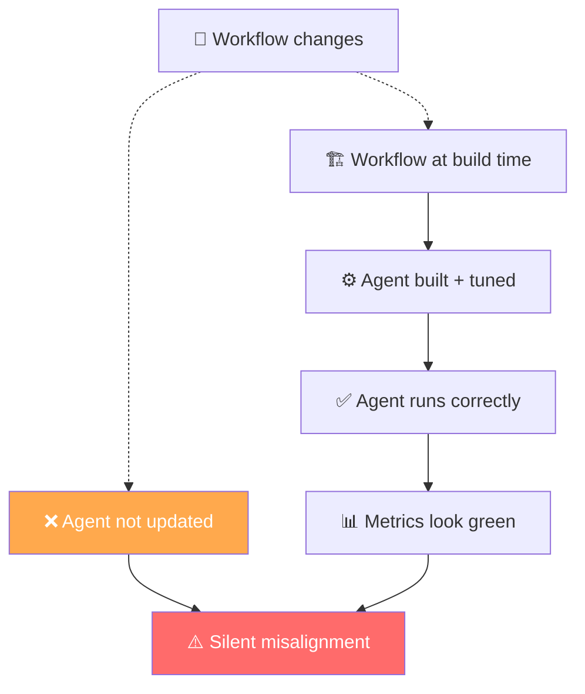

We built an agent to route inbound support tickets. It categorized each one by team, urgency, and product area, then dropped it into the right queue. Took about two weeks to build and tune. Worked well.

Three months later, we reorganized. Two support teams merged into one. The routing categories changed. The SLA targets shifted. We updated the Notion docs, sent an all-hands message, moved the Jira boards around.

Nobody touched the agent.

Six weeks after that, someone pulled the ticket distribution data and noticed 23% of tickets were landing in a queue that no longer existed as a separate entity. The agent was completing every task. Error rate: 0%. Completion rate: 100%. But it was routing tickets based on a team structure that hadn't existed for nearly two months.

## The Failure Mode Nobody Monitors For

This isn't a crash. It's not a timeout or a retry loop or a broken API call. The agent ran exactly as designed. It just wasn't designed for the workflow that existed anymore.

Every metric looked fine. That's what makes it dangerous.

Most teams watch for agents that fail. They set up alerts on error rates, latency, and task completion. What they don't watch for is agents that succeed at the wrong thing. An agent can produce correct output for an outdated problem and nothing in your monitoring stack will catch it.

## Three Times We've Seen This

**The routing agent** is the example above. But it's not unique.

We had a content agent that wrote product descriptions for a specific market segment we'd been targeting. Mid-year, we shifted positioning. The agent kept writing in the old voice, for the old customer profile. The descriptions weren't wrong. They just didn't match what we were selling anymore. It took two months and a customer interview to surface the problem.

We had a data extraction agent that pulled from an API field our data team had quietly deprecated. The field still returned values, just stale ones. The agent processed thousands of records before anyone checked the actual output rather than the completion count.

In every case, the agent did exactly what it was told. The problem was that what it was told no longer matched what was needed.

## Why This Keeps Happening

Agents get built during a specific moment in your workflow's life. They encode the assumptions, categories, and priorities that existed when someone wrote the prompt. Then the workflow moves on and the agent doesn't.

Part of it is that agents look like infrastructure. Once they're running, they feel like plumbing. You don't expect to revisit them unless something breaks. But an agent isn't a database migration. It's an active participant in a workflow that keeps changing.

Part of it is that the feedback loop is broken. When a human does the wrong work, someone notices and redirects them. When an agent does the wrong work, it completes silently and the result sits in a queue or a database or a spreadsheet until someone reads it carefully enough to realize it's off.

## What to Actually Do About It

There's no automated fix here. This is a process problem, not a monitoring problem.

The closest thing to a solution is treating every significant workflow change as a trigger for an agent audit. When teams restructure, when a product changes, when SLAs shift, when customer segments evolve, that's when you check whether the agents built around those things still match current reality.

This is easier to do if you keep a short list of which agents are tied to which workflows. It doesn't need to be a formal document. It can be a section in your team wiki or a column in a spreadsheet. The point is to have a way to answer "which agents might be affected if this changes?" before the change ships, not six weeks after.

You can also build a light manual review step into any high-volume agent. Not every output, just a random sample, once a week. [AgentCenter's deliverable review workflow](/features/agent-monitoring) makes this easier when agents are producing structured outputs. The goal isn't to review everything. It's to maintain enough contact with what the agent is actually doing that drift doesn't go unnoticed for months.

## Who This Matters Most For

This problem shows up most often in teams that grew their agent fleet quickly and haven't revisited the earlier agents since. You ship agents during a build phase, move on to the next problem, and the old ones keep running in the background.

It also hits teams that have been through any kind of reorganization: team structure changes, product pivots, or shifts in the customer base. These are exactly the moments when the assumptions baked into your agents stop being true.

If your team has been running agents for more than six months and nobody has done a full pass to check whether each agent still matches the workflow it was built for, there's a reasonable chance at least one of them is solving a problem that's changed.

## The Honest Caveat

None of this is unique to AI agents. Automation in general has this problem. Scripts go stale. Scheduled jobs outlast the workflows they were built for.

But AI agents are particularly hard to catch because they produce output that looks reasonable even when it's wrong. A routing agent that drops tickets into a deprecated queue still routes them somewhere. A content agent with stale positioning still produces readable text. There's no error. There's no exception. There's just work that doesn't quite match what you need anymore, done at scale, until someone looks closely.

The answer is the same thing that makes agents work at all: human review. Not constant review, but deliberate, periodic review that asks not just "did the agent complete the task" but "did the agent complete the right task for where we are today."

---

*The dashboard won't fix a broken agent. But it will tell you which one is broken at 3am. [Try AgentCenter free](/pricing).*
