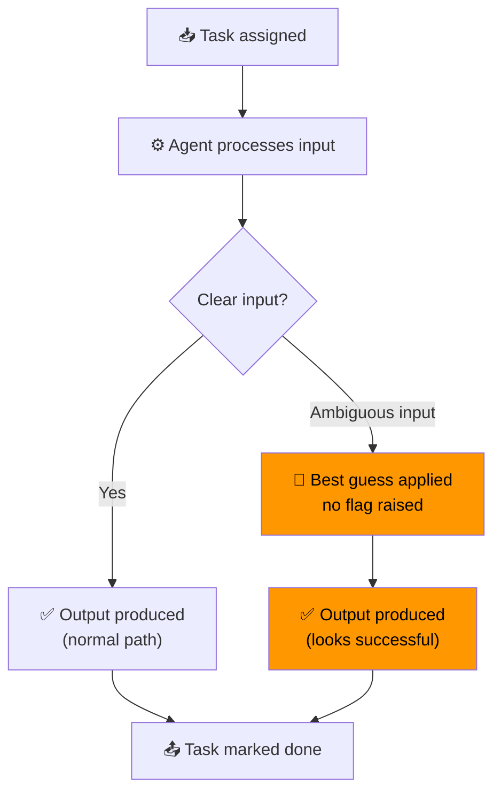

Our document processing agent ran 1,400 invoices through a pipeline last month. For 87 of them, the vendor field was blank or corrupted. The agent didn't crash. It flagged nothing. It extracted what it could, filled the rest with nulls, and kept moving.

The finance team noticed eleven days later when reconciliation failed. By then, 87 invoices had been processed with missing vendor data, some had been paid, and cleaning the mess took most of a day.

The agent never escalated to a human. It had never been given a way to.

## The Model Default Is "Keep Going"

Language models don't have a natural "I'm unsure, pause here" state. They're trained to produce output. When a model hits ambiguous input, it defaults to its best guess and continues. That's usually the right call. But in production workflows, "best guess on bad input" can mean corrupted records, wrong approvals, or escalations that quietly never happen.

This isn't a bug. It's how the model works. The problem is that most teams build their agents with two outcome states: success and error. They handle exceptions. They write retry logic. They add alerts for failures.

Nobody adds an alert for "agent completed 1,400 tasks successfully, but made a best-guess call on 87 of them."

## Three Patterns That Show Up Again and Again

**The silent best-guess.** An agent encounters input it has no clear rule for. It produces output that looks plausible. The output passes downstream validation because the schema is correct, even when the values aren't. Nobody finds out until a human audits a batch downstream.

**The wrong escalation path.** A customer support agent handles returns and billing questions. A customer writes in with a legal complaint. The agent has no "escalate to legal" path. It picks the closest category available, billing dispute, and routes it there. The right person doesn't see it for four days.

**The completed-but-incomplete task.** A research agent finishes a summary. The output is well-formatted and passes all quality checks. But the agent hit a paywall on one key source and silently skipped it. The summary is missing the most relevant data point. No alert fires because there's no "incomplete source coverage" state.

Here's how each of these looks from the task log:

Two green checkmarks. No way to tell which path the agent actually took.

## What Most Monitoring Misses

[Agent monitoring](/features/agent-monitoring) does well at catching hard failures: timeouts, API errors, exceptions, rate limits. If your agent crashes, you'll hear about it.

What most setups don't track: inputs that triggered fallback logic, outputs produced under low confidence, cases where the agent made a call it wasn't clearly equipped to make.

The agents that cause the most downstream damage aren't the ones that fail loudly. They're the ones that succeed quietly on bad input.

This matters more than it sounds. Human reviewers spot-check successful outputs far less often than they investigate failures. So bad output that arrives labeled "done" often sits unquestioned until something downstream breaks.

## What Agent Escalation to Humans Should Look Like

The fix isn't complicated, but it needs deliberate design. Your agents need a third outcome beyond "done" and "failed": needs human review.

That state should trigger the same way an error does. An alert fires. A task gets assigned to a specific person. It lands somewhere visible, not in a log file that nobody reads.

In practice, this means four things:

1. **Define the uncertain cases.** For each agent, list the input conditions where confidence is low or where a wrong decision has real cost. Missing required fields. Conflicting signals. Inputs that fall outside normal operating range.

2. **Make the agent stop.** When one of those conditions is hit, the agent should not continue guessing. It should produce a "needs review" result with a clear description of what it encountered.

3. **Route it to a human.** That result goes into a task queue, not a log. Someone reviews it, decides, and the agent continues with corrected input or a clear direction.

4. **Track the rate.** How often is your agent hitting these cases? If it's 0.1%, that's expected variance. If it's 12%, the agent's scope is mismatched to its actual inputs and that's a design problem worth fixing before the next cycle.

The [task board in AgentCenter](/features/task-orchestration) has a blocked state for exactly this reason. An agent can mark a task as blocked, assign it to a team member, and add context about what it needs. It doesn't keep guessing. The human sees it in the queue, reviews it, and clears it. The agent picks up where it left off.

## Who This Hits First

Teams with agents making decisions that affect real downstream outputs: invoices processed, emails sent, records updated, documents approved. The lower the human review rate after the agent runs, the more this matters.

Teams that get burned here usually built their automation well. They just didn't build a way for the agent to say "I need help on this one." So the agent did what it was trained to do: produce an output and move on.

If you're running agents in any workflow where a wrong answer has real cost, the most useful thing you can add isn't better prompts. It's an explicit escalation state and someone responsible for reviewing it.

## The Honest Caveat

Adding human review checkpoints slows things down. If your agent processes 2,000 tasks a day and 5% need human review, that's 100 reviews a day. That's a workload, not a footnote.

The answer isn't to review everything. It's to be specific about which decision types carry enough risk to warrant it. Not every ambiguous input is dangerous. But some are, and it's worth knowing which ones before something downstream breaks.

---

*The dashboard won't fix a broken agent. But it will tell you which one is broken at 3am. [Try AgentCenter free](/pricing).*
