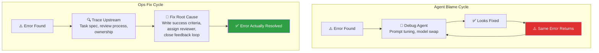

We deployed nine agents last quarter. One of them, a contract review agent, kept producing summaries that were almost right. Wrong clause counts. Missing risk flags. The kind of output that looks fine at a glance but falls apart on a closer read.

We spent three weeks on it. Rewrote the prompt four times. Switched models. Added chain-of-thought instructions. Nothing held.

Then someone finally asked: what does a correct summary actually look like? Who decides? Where is that definition written down?

There wasn't one.

## The Pattern Nobody Warns You About

The agent wasn't broken. The process around it was broken.

The agent was doing what it was configured to do, as consistently as it could. The problem was that nobody had defined what "correct" looked like. Nobody was reviewing outputs against any standard. When errors surfaced, the feedback went to the engineer who built the agent, who had moved on to three other projects. Nothing got fixed in any systematic way.

This pattern is more common than most teams want to admit. You're debugging an agent that isn't actually the problem.

## Three Failure Modes That Aren't Agent Failures

After watching this play out across enough teams, the upstream failures cluster into three types.

**The undefined success criteria problem.** If you can't write down what a good output looks like, the agent can't know when it's wrong, and you can't tell when it's right. Teams skip this step because it feels obvious. The output is either good or it's not, right? In practice, "good" means different things to the three people reviewing it. The agent gets blamed when the real issue is that nobody agreed on the target.

**The optional review problem.** Agents produce outputs, but reviewing them is nobody's job. It gets done when someone has time, which means it often doesn't happen. Errors accumulate. By the time someone notices, the agent has been wrong for two weeks. The volume of tasks passing through [agent monitoring](/features/agent-monitoring) can make this invisible — everything shows as "completed," which looks like success.

**The broken feedback loop problem.** An error gets found. Someone tunes the prompt. The same error comes back two weeks later. There's no systematic way to track what broke, what fix was tried, whether the fix held. The next person who notices the problem starts the cycle from scratch.

## What to Check Before Touching the Prompt

Before you change anything in the agent, answer three questions.

Is there a written definition of what good output looks like? Not in someone's head. Written down, shared, and agreed on by whoever uses the output. If the answer is no, write it first. You can't evaluate agent quality without it.

Is someone reviewing outputs on a regular schedule? Not when they have time. On a schedule, with a scope — how many tasks per week, sampled or full, and by whom. If review is optional, errors compound silently.

When an error is found, is there a clear path from "this output was wrong" to "agent updated, fix confirmed"? If that path doesn't exist, you're not running an agent, you're running a hope. The same errors will keep recurring because there's no mechanism to close the loop.

All three questions are process questions. None of them are about the model, the prompt, or the agent infrastructure.

## Who Gets Stuck Here

This tends to hit teams in a specific window: past the prototype phase, not yet running a mature operation. You've built agents and they're in production. But the operating model hasn't caught up. Each agent has a different owner, or no clear owner. Review happens informally. When something breaks, it's not obvious whose problem it is.

Teams running between 5 and 20 agents are particularly exposed. Small enough that things feel manageable. Large enough that informal coordination starts breaking down.

The [AgentCenter dashboard](/features/agent-dashboard) makes task status, review history, and error patterns visible across the whole fleet. That visibility helps — it's easier to see where review gaps exist, which tasks are aging without review, and which agents are throwing repeated errors. But visibility doesn't write success criteria. It doesn't assign reviewers. It makes the gaps obvious. The decisions are still on the team.

## The Honest Version

Some agent problems genuinely are about the agent. Bad model outputs, reasoning errors, hallucinations on specific input shapes. Those happen. But they tend to be obvious. They produce dramatic failures, not slow drift.

The failures that persist for weeks, that resist prompt tuning, that keep coming back after you thought you fixed them: those almost always have a process cause upstream. Check the task definition before you touch the model. Check the review process before you debug the output logic. Check the feedback loop before you declare anything fixed.

Most of the time, the agent is the last place you should be looking.

---

*The dashboard won't fix a broken agent. But it will tell you which one is broken at 3am. [Try AgentCenter free](/pricing).*
