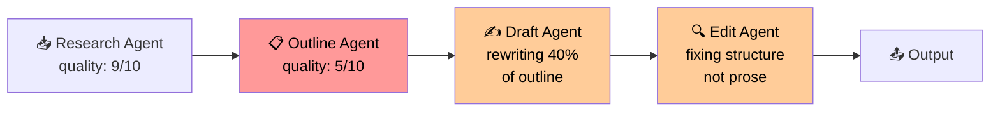

We had four agents in a content pipeline. One researched the topic, one outlined, one drafted, one edited. We'd spent two months improving the draft agent — better prompts, better examples, more context. Quality scores from the edit agent went up.

Then we looked at what the edit agent was actually doing.

It was rewriting the outline step's output every single time. Not correcting the draft. Correcting the structure that should have come in clean. The outline agent was the problem, and we'd been paying for an expensive editor to fix it, run after run.

That's the weakest link problem. Every multi-agent pipeline has one.

## The Mistake Teams Make When Building Pipelines

When you build a multi-agent pipeline, you think about each agent individually. Does the research agent get good information? Does the draft agent write well? You test them in isolation, run a few end-to-end tests, and ship.

What you don't do is measure which step contributes most to downstream failure.

In a pipeline, what matters isn't just the quality of each step in isolation. It's the cumulative effect across the chain. A mediocre step early in the chain doesn't just produce mediocre output. It makes every downstream agent's job harder. And when those agents compensate — by guessing, by rewriting, by adding their own assumptions — errors multiply.

The weakest link isn't necessarily the agent that fails. It's often the agent that passes, with output that looks fine in isolation but quietly breaks everything after it.

## What the Weakest Link Actually Looks Like

In the content pipeline, the outline agent's output wasn't obviously bad. It produced a coherent outline every time. No errors. No timeouts. It passed basic format checks.

But when we measured how much the downstream draft agent deviated from the outline, the numbers were striking. The draft agent was ignoring 40% of the structure and rewriting from scratch. That meant the editor was reviewing work that had already diverged from the original spec. The researcher's inputs were effectively being discarded midway through.

Three agents doing real work, undone by one that looked fine.

Other patterns to look for:

**The compensating agent.** One step in your pipeline has unusually high token usage compared to its input size. It's doing something expensive. Often this is because it's reprocessing or second-guessing what came before it.

**The repair loop.** A downstream agent frequently retries, produces short outputs, or appends hedging language to its responses. This usually means the input spec it received wasn't good enough.

**The silent filter.** An agent receives 100 items and passes 60 downstream. You assumed all 100 would pass. No one noticed the 40 that dropped. That filtering step is now a hidden control point for your entire output volume.

## How to Find Yours

You're not looking for the agent that throws errors. You're looking for the agent whose output causes the most work downstream.

Three things to measure:

**1. Handoff rejection rate.** When an agent's output arrives at the next step, how often does that step retry, request more context, or route to a human? A rejection rate above 15-20% is a signal worth investigating.

**2. Token use by stage.** Pull the token counts for each step, normalized by input size. A step using 3x the tokens of the others isn't doing 3x the work. It's often undoing work that came before it.

**3. Output deviation from spec.** If your pipeline has a defined output format at each stage, measure how often downstream agents receive output that doesn't match the spec. Even small deviations compound.

These aren't hard to measure. Most agent monitoring tools surface token counts and task duration per step. What you're adding here is pairing those numbers with what happens next — not treating each agent as standalone. AgentCenter's [agent monitoring](/features/agent-monitoring) gives you per-task duration and status at each stage, which is where this analysis starts.

## The Fix Is Usually Upstream

Once you find the weakest link, the instinct is to fix the agent at that point. Better prompt, more examples, different model.

Sometimes that's right. But more often, the weak link's problem isn't solvable without changing what it receives.

In our case, we didn't touch the outline agent's prompt first. We fixed what the outline agent was given: a clearer task spec from the research agent, with a required output structure that constrained what the outline had to work with. Outline quality improved significantly. Not because we changed the outline agent at all.

The weakest link is often doing its best with what it gets. Before you fix the link, look at the chain. This is exactly where [task orchestration views](/features/task-orchestration) help — you can trace handoffs between agents and see the input each step receives, not just the output it produces.

## Who This Matters Most For

This problem hits hardest when you're running more than three agents in sequence. At two agents, you can see what's happening. At four or more, the feedback loop between steps gets complex enough that problems become hard to attribute without measurement.

It also matters if you've been tuning your agents for weeks and seeing diminishing returns. That's often a sign you're working on the wrong step.

And it matters if humans review only the final output — not the intermediate steps. That pattern is common, and it means your weakest link is invisible until something fails badly enough to trace upstream.

## An Honest Caveat

Not every pipeline has a single obvious weakest link. Some have two steps that are equally flawed, or a problem that's distributed across a bad handoff spec rather than any one agent. Metrics help with the first case. The distributed problem is harder: it usually requires reading intermediate outputs manually, not just looking at dashboards.

And sometimes the problem really is in the final step. Don't assume it's always upstream. Measure first, diagnose second.

## What to Actually Do Tomorrow

Pick your most important multi-agent pipeline. Pull the token count and task duration for each step. Look for the one that's running 2x or 3x longer than you'd expect given its input. Then look at what the next step does with that output.

That's where your weakest link is hiding.

---

*The dashboard won't fix a broken agent. But it will tell you which one is broken at 3am. [Try AgentCenter free](/pricing).*
