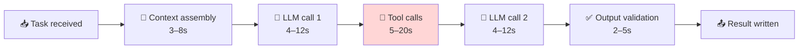
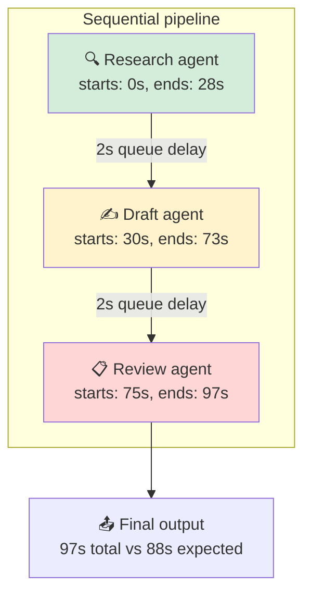

We measured our agents for the first time three months after deploying them. Not because we were lazy. Because nothing was obviously broken.

The reports looked fine. Tasks were completing. The business was happy.

Then we timed each step. Our fastest agent was taking 47 seconds per task. We had assumed it was running in under 15.

That gap — between assumed and actual runtime — is one of the most common blind spots in production agent systems. And it compounds badly as you add more agents.

## Why Your Mental Model Is Wrong

Developers tend to estimate agent speed at the model call level. They know GPT-4 or Claude takes a few seconds per inference. They add up the expected calls and arrive at a number.

What gets missed:

- Tool call latency (database lookups, API calls, file reads)
- Context assembly time (building the prompt before each LLM call)
- Inter-step wait time (when Agent B waits for Agent A to finish)
- Output post-processing (parsing, validation, reformatting)
- Retry cycles that trigger silently when validation fails

None of these appear in your back-of-envelope calculation unless you have actually measured them. Most teams haven't.

## Where the Time Actually Goes

Here's what a typical agent pipeline looks like when you break down the timing:

LLM calls get most of the attention. But in real pipelines, tool calls account for 30–60% of total latency. A database query taking 2 seconds per call. An external API that occasionally spikes to 8 seconds. File reads that are deceptively slow at volume.

Context assembly is the second invisible cost. Before each model call, your agent might be pulling from a vector store, concatenating conversation history, fetching user preferences, and serializing everything into a prompt string. That work happens before the model even starts thinking.

## Silent Retries Are a Time Sink

When a task fails validation and retries quietly, you see nothing unless you are specifically logging retry events.

An agent that "takes 45 seconds" might be completing in 15 seconds, failing, waiting 10 seconds, retrying, and finishing in another 20. The final output looks fine. The runtime is 3x what it should be.

The dangerous thing about silent retries is that teams use average task time as their performance benchmark. If 20% of your tasks are retrying twice, your mean runtime hides a large population of slow outliers.

What actually matters is the 90th percentile runtime, not the mean.

## How Multi-Agent Wait Time Compounds

When agents depend on each other, idle time stacks up across the pipeline.

If Research finishes in 28 seconds but Draft does not start for 30 seconds due to queue delay, 2 seconds disappear with no error, no alert. If Review receives a longer draft than expected and takes 22 seconds instead of 20, there is more slippage.

These small gaps add up fast when you run dozens of concurrent pipelines. A workflow that should take 88 seconds starts averaging 110. Nobody notices because no task is technically failing. The pipeline is just slow.

## How to Actually Find It

You do not need sophisticated tooling to start measuring. You need timestamps at the right places:

1. Task start time
2. Each subtask start and end time
3. Each tool call start and end time
4. Retry count per step
5. End-to-end completion time

With those five data points, you can calculate where time is going.

AgentCenter's [agent monitoring dashboard](/features/agent-monitoring) shows per-task timing and retry counts directly. You can see whether a specific agent type consistently runs slower than others, or whether one tool call is eating most of your latency budget. No custom instrumentation required.

The activity feed is also useful. Watching a few tasks run in real time shows you the actual sequence in a way that aggregate dashboards do not.

## The Decision This Unlocks

Once you know where the time goes, you have a concrete decision to make: is this latency acceptable for the task type, or does it need attention?

Some tasks do not need to be fast. A nightly batch agent that takes 8 minutes is fine.

Other tasks sit in a human-facing loop, where 47 seconds feels like a broken product. Those are the ones worth fixing.

The common mistake is trying to speed up every agent uniformly. The right move is to identify which agents are latency-sensitive and fix those first. [AgentCenter's feature set](/features) helps you surface this without building a custom monitoring layer.

## Who Needs to Think About This

If you are running fewer than 5 agents and nothing is customer-facing, you probably do not need to worry about this yet.

If you are running 15 or more agents, or any agents inside a customer-facing workflow, you almost certainly have latency problems you do not know about. Not because you built it badly. Because you have not measured it yet.

Teams moving from prototype to production consistently report the same thing: their assumed runtimes and their measured runtimes were different, often by 2x or more.

## An Honest Caveat

Measuring latency tells you where time goes. It does not automatically tell you why.

A slow tool call might be a slow vendor, a poorly written query, or an architectural mismatch. A high retry rate might be a prompt problem, an output validation issue, or intermittent flakiness in a dependency.

Measurement narrows the problem. Diagnosis is still your job.

AgentCenter shows you the patterns. Fixing them is still engineering work.

---

*The dashboard won't fix a broken agent. But it will tell you which one is broken at 3am. [Try AgentCenter free](/pricing).*
