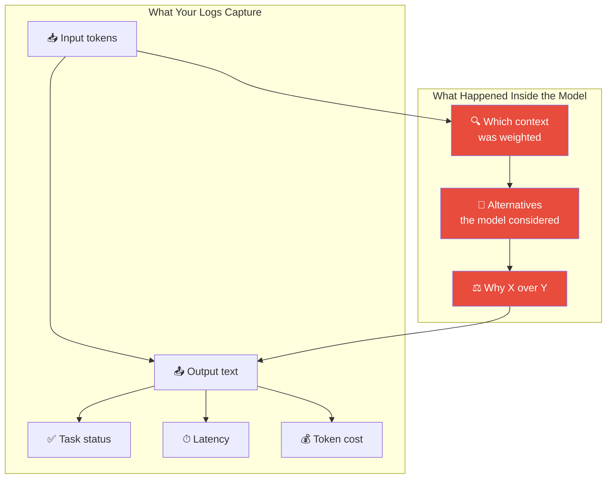

The agent ran at 11:47am on a Tuesday. It sent the output. By 2pm someone noticed the recommendation was wrong.

You pull up the task. Status: completed. Latency: 8 seconds. Tokens: 1,200. LLM call: successful.

Everything looked fine. The agent did exactly what it was told. And yet the wrong thing happened.

The first question everyone asks is: why did it do that?

You can't answer it. Not from the task log. Not from the monitoring dashboard. Not from anything the agent left behind.

## The Gap Nobody Warns You About

Logs tell you what happened. They don't tell you why.

This sounds abstract until you need to explain a decision to someone. A customer, a compliance reviewer, a manager trying to understand an incident. "The agent ran and produced this output" is not an explanation. It's a description.

With code, you can trace back. Set a breakpoint. Read the conditional logic. The "why" is in the code itself.

With agents, the reasoning happens inside the model's inference pass and then disappears. You get the input. You get the output. You don't get the working.

For most tasks, this doesn't matter much. If the agent is writing a draft and it gets a sentence wrong, you fix it.

The problem starts when the agent's decision has real consequences. When it chose which pricing tier to recommend. When it decided to escalate a support ticket or resolve it. When it picked which data source to trust first. Those decisions leave marks. And eventually someone will need to explain them.

## What Your Logs Capture vs. What Actually Happened

Here's the gap as it exists in most production setups:

The red boxes happened. They're just not in your logs.

## Three Situations Where This Actually Hurts

**When the output changes between runs.** Same input, different output. You want to know what shifted. Without any decision-level context, all you can compare is the inputs and outputs. You can't tell which part of the reasoning changed, or whether the change is a fluke or a pattern.

**When you need to audit a decision.** "Why did the agent recommend the enterprise plan to this customer?" You can show them the input. You can show them the output. You cannot show them the reasoning. That rarely satisfies anyone who has accountability for the result.

**When you're trying to improve the agent.** You want to make it better at a specific case type. But you can't see which cases it's reasoning through correctly versus consistently getting wrong. Prompt changes become guesswork.

## What You Can Do About It

You're not going to get a full reasoning trace from inside the model. But you can reduce the gap.

**Ask the model to explain its output.** Structure the output so it includes a brief reasoning field alongside the answer. Not just "Recommendation: Plan B" but "Recommendation: Plan B. The input indicated a team of 12 with 3 active projects, which exceeds the Starter tier limit." Store that field. It won't always be accurate — models can generate plausible-sounding justifications that don't reflect their actual inference — but it gives you something to compare and audit over time.

**Log what was present at decision time.** When the agent runs, record the inputs that matter: customer segment, configuration version, prompt version, which tools were available. Not the full inference trace, but the factors that could explain variance. When output changes, you have something to correlate against.

**Categorize outputs, not just statuses.** If your agent makes decisions, add a decision category to each task. "Escalated" vs. "Resolved." "Recommended upgrade" vs. "Did not." Aggregating these categories over time reveals patterns that raw output logs don't.

The [agent monitoring setup](/features/agent-monitoring) in AgentCenter stores metadata fields alongside each task run. When you're reviewing a task six hours after it ran, you're not just looking at a timestamp and a status — you can see what was passed in, tag the run with contextual labels, and filter task history by those tags when you're trying to trace a pattern. It won't reconstruct the model's reasoning, but it closes enough of the gap to make post-hoc review useful.

## Who Needs to Think About This First

If your agents are read-only, the stakes here are low. A bad summary is a bad summary.

But if your agents write to anything real — send emails, create records, update databases, make recommendations that get acted on without a second look — you'll eventually have to explain a decision. The question is whether you built the infrastructure to explain it before or after the incident.

The teams that feel this first are usually engineers inheriting agents they didn't build. No documentation. No decision log. No understanding of why the agent behaves one way in edge cases and a different way in others. Just: it usually works. Sometimes it doesn't. Nobody knows why.

## The Honest Limitation

There's no perfect fix here. LLMs don't run on traceable if-else logic. Even with structured reasoning output, the model is telling you what it thinks it reasoned — not a ground truth of what happened inside the inference pass. The explanation can be post-hoc rationalization.

What you can aim for is "explainable enough to be accountable." Not perfect transparency, but enough context to spot patterns, answer basic audit questions, and make informed decisions about when a task needs a human in the loop.

That standard is achievable. It just requires treating decision logging as a first-class concern when you build the agent — not a feature you add after your first unexplainable failure.

---

*The dashboard won't fix a broken agent. But it will tell you which one is broken at 3am. [Try AgentCenter free](/pricing).*
