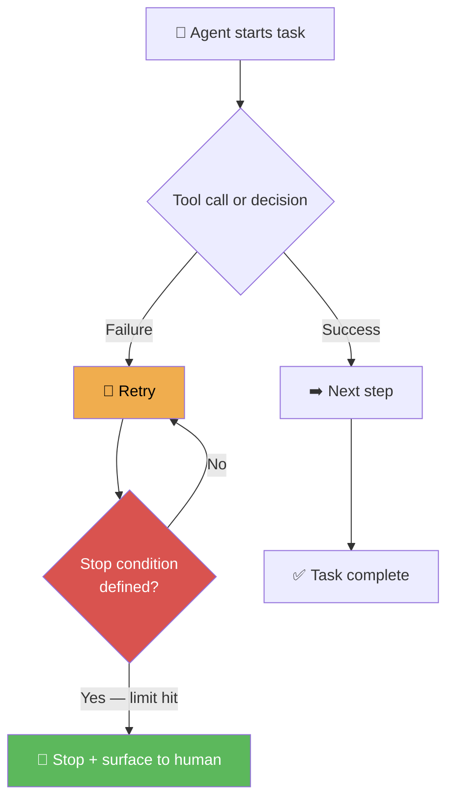

We had an agent spin for 47 minutes on a task that should have taken 90 seconds. Nobody knew. The [agent monitoring](/features/agent-monitoring) dashboard showed status: running. Which was true. When we finally dug into the logs, it had made 340 API calls trying to resolve a tool error that was never going to fix itself.

The patch took two lines. The cost was half a day of investigation, a surprise API bill, and several downstream tasks that had been silently waiting.

But the real finding wasn't the bug. It was the assumption baked into how we'd built the agent: that stopping was optional.

## Agents are built to finish, not to quit

Most agent frameworks are optimized for the success path. You define the goal, the tools, the instructions. The agent tries to reach the goal. If it hits an obstacle, it retries. If it retries and fails, it retries again, because that's what the default loop does.

Nobody writes the part of the spec that says: after 3 consecutive tool failures, stop and surface this to a human.

Teams skip that step for two reasons. First, it feels like pessimism during the build phase. You're excited about what the agent can do. Thinking through failure modes is a distraction. Second, it's genuinely hard to enumerate all the ways an agent can get stuck before you've seen them in production.

So most agents ship without stop conditions. And they work fine, until they don't.

## What stuck agents actually look like

The stuck-agent pattern usually has one of three forms.

**Retry loops.** The agent hits an error, retries, hits the same error, retries again. No circuit breaker. This goes on indefinitely. Token costs accumulate. Downstream tasks wait.

**Decision loops.** The agent can't choose between two options because the instructions are ambiguous or the input data is unclear. So it evaluates, makes a tentative choice, second-guesses it, evaluates again. This is subtler than retry loops because the agent isn't erroring — it's just thinking. And thinking.

**Scope drift loops.** The agent finishes the main task but then starts doing tangentially related things it wasn't asked to do, because the instructions were broad enough to allow it. It keeps going until the context window fills or something external stops it.

All three look the same from the outside: the task is running.

Without explicit stop conditions, agents loop on the left side of that diagram. The right side — stopping and surfacing — only exists if you build it in.

## Why teams don't catch this until it's expensive

There's a gap between what monitoring tools show and what you actually need to know.

Most dashboards will tell you an agent is running. They'll show token count, elapsed time, tool call count. What they don't tell you is whether the agent is *making progress*. A stuck agent and a slow agent look identical from a status line.

This is where [AgentCenter's real-time agent monitoring](/features/agent-monitoring) helps. When you can see task timelines — specifically when a task has been in the same state for an unusual length of time — you can catch stuck agents before they burn through a day's API budget. The activity feed means you're not waiting for an error to surface; you're watching the pattern.

But even with visibility, you need something to look for. If you've never defined "how long is too long for this task," you won't notice when it crosses that line.

## The habit that changes this

Before any agent goes to production, answer two questions.

**First: what's the maximum number of retries before we escalate?**

Pick a number. Three is common. Five for long-running tasks. The specific number matters less than having one.

**Second: what does "I can't continue" look like for this agent?**

Some agents can't proceed if a specific file is missing. Others can't proceed if a tool returns an unexpected format. Others get blocked when two instructions contradict each other. Map those conditions. Then write the stop behavior: log the issue, mark the task as blocked, notify whoever owns the workflow.

This is less satisfying than prompt engineering. It also prevents the 47-minute loops.

## Who this matters most for

Teams running agents in automated pipelines with no human in the middle. If your agent handles tasks and hands results directly to another system — no review step, no human check — a stuck agent is invisible until something downstream fails.

Also relevant: teams running cost-sensitive workloads. A looping agent hitting a paid API endpoint 400 times in an hour isn't a hypothetical. It shows up on the bill and nobody knows why.

If you're running more than 5 agents in production, the probability that at least one has gotten stuck without you knowing is high. [AgentCenter's task orchestration view](/features/task-orchestration) gives you task history and timeline visibility, so you can actually check.

## The honest caveat

Stop conditions don't prevent agent failures. They make failures visible and bounded. An agent that can't resolve a permission error is still broken — stopping after 3 retries doesn't fix the underlying problem. What it does is stop the bleeding and surface the issue so someone can actually investigate.

If your agents are getting stuck regularly, the stop condition is the early warning system, not the fix.

---

*The dashboard won't fix a broken agent. But it will tell you which one is broken at 3am. [Try AgentCenter free](/pricing).*
