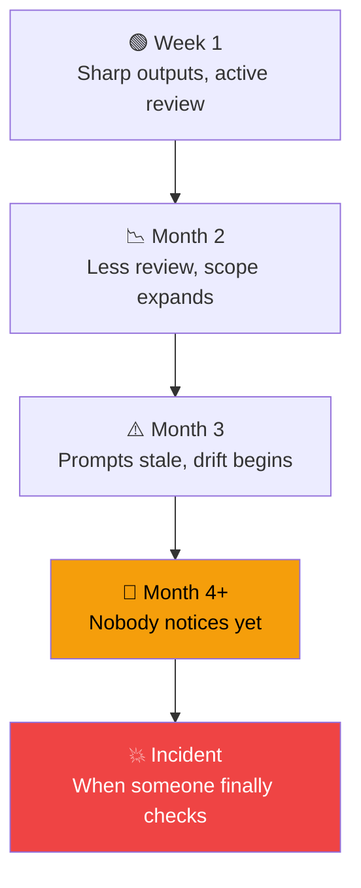

We deployed an agent in February. By April, it was still running. Still producing output. Nobody had filed a bug on it.

But when we actually looked at what it was doing — compared to what it was doing in week one — something had shifted. The outputs were technically valid. They just weren't as good. They were drifting. And we hadn't noticed because we stopped reviewing them.

That's the pattern we've seen over and over. An agent at week one is sharp, intentional, carefully scoped. By month three, it's a different animal.

## Why Agents Are at Their Peak Right After Deployment

When you first deploy an agent, a few things are true that won't stay true for long.

**You're paying attention.** The first week, someone is watching every output. Flagging edge cases. Tuning. There's active human feedback in the loop.

**The scope is tight.** You built it for one thing. You haven't added "oh, can you also..." yet. It's doing exactly what it was designed to do.

**The context is accurate.** Your prompts were written last week. The data they reference is current. The instructions haven't gone stale.

**Dependencies are pinned.** Whatever external services, data feeds, or upstream processes the agent touches — they're configured the way you tested them.

All of that starts to erode the moment you leave it running.

## What Changes Without You Noticing

**Prompt aging.** The instructions you wrote last January assumed your product, your customers, your data structures were a certain way. They're not that way anymore. The agent doesn't know. It's still following instructions for a world that's changed.

**Scope creep.** Someone sends a task that's adjacent to what the agent was built for. It handles it well enough. Now it's a pattern. Nobody updates the formal scope. The agent is doing three things, and you only tested one.

**Dependency drift.** An upstream API changed its response format. A database table got new columns. An external data source is slower now. The agent adapts — partially, incorrectly, silently.

**Attention decay.** In week one, someone reviewed every output. Now it's once a week. Then spot-checks. Then "it hasn't broken, so it's fine." The reviews that would catch drift stop happening because nothing has visibly broken yet.

This is how you end up with an agent that's technically running but functionally not doing its job.

## The "It's Still Running" Trap

An agent that crashes is annoying. But at least you know about it.

An agent that's running, producing output, and slowly degrading in quality? That's the harder problem. Nothing pages. Nothing alerts. It's using your tokens, touching your data, and the results are fine-ish.

This is where [agent monitoring](/features/agent-monitoring) matters most — not just "is the agent up?" but "is what it's producing still correct?" Those are different questions with very different answers. Uptime doesn't tell you much about quality.

The failure mode is subtle. The agent is still completing tasks. The completion rate looks fine. Token usage is normal. But the actual value of what it's producing has dropped, and you won't know until a human reads the output and goes "wait, this is wrong."

## What Good Longevity Looks Like

Agents that stay sharp over time have a few things in common.

**Someone owns them.** Not "the team" — a specific person. That person does periodic output reviews. Not to babysit the agent, just to notice drift before it becomes a problem. If no one owns it, no one notices.

**Prompts are versioned.** When you update a prompt, you know when it changed and why. When something breaks, you can trace back. When the world the agent operates in changes, you update the instructions to match.

**Scope is written down.** What this agent does. What it doesn't do. When something out-of-scope comes in, there's a conscious decision: expand, reject, or route elsewhere. Not just "sure, it can probably handle that."

**Reviews are scheduled, not reactive.** Most teams review agent outputs when something goes wrong. The teams that maintain quality over time review on a cadence — weekly, monthly, whatever fits the task. The review happens before the incident, not after.

## Where to Start

If you have agents that have been running for more than a few weeks without a formal quality check, that's the first thing to do. Pull the last 20 outputs and actually read them. Compare against what the agent was producing in its first week if you have that history.

What you're looking for: are the outputs still doing what you originally intended? Are they hitting edge cases they shouldn't? Are they skipping things they used to handle?

If you don't have that history, you're flying blind. [A dashboard that shows agent activity over time](/features/agent-dashboard), not just current status, lets you spot the moment things start to shift.

## Who This Matters Most For

This is most visible for teams running agents that handle ongoing, recurring work — weekly reports, customer-facing summaries, data pipeline outputs, content generation. One-shot agents are lower risk. Agents that run every day, handling the same type of task over and over, accumulate drift.

If you're a solo founder, you might be the only person who ever notices. That's fine — block an hour every few weeks to actually look at what your agents produced. Not just that they ran. What they produced.

If you're on a team with five or more agents, you need something more systematic. Informal reviews don't scale past two or three agents.

## The Honest Caveat

Not every agent ages badly. Some tasks are stable enough — structured input, well-defined output, no external dependencies — that an agent can run for months without meaningful drift. Those exist. But they're the exception.

Most agents that handle real-world work are touching things that change. Assume drift. Build review in. Don't wait until someone complains about the output before you look at what the agent has been doing.

AgentCenter won't stop your agents from aging. But it gives you the visibility to notice when they do, and the workflow to do something about it before an incident forces your hand.

---

*The dashboard won't fix a broken agent. But it will tell you which one is broken at 3am. [Try AgentCenter free](/pricing).*
