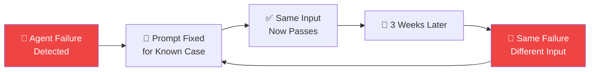

Last month, one of our agents misclassified a batch of customer support tickets. Priority one items got routed to the backlog. We caught it, fixed the prompt, called it done.

Three weeks later, the same agent failed again. Different tickets, different wording. Same underlying mistake — it couldn't distinguish between "urgent" framing in a casual tone and actual urgency signals. The original fix had patched the exact case we tested. It hadn't addressed the pattern.

That gap — between fixing an incident and fixing a failure mode — is where most teams lose ground.

## The Core Problem: Agents Start Fresh Every Time

Your codebase accumulates knowledge. A bug fix becomes a test. A test becomes part of the suite. The next developer who writes similar code hits a failing test before they ship. The failure teaches the codebase something durable.

Your agents don't work that way.

Every time an agent runs, it starts from zero. It has no memory of last Tuesday's failure. It has no internal state that says "we got this wrong before." The prompt you wrote six weeks ago runs exactly as it did then — unless you manually changed it.

Without deliberate intervention, agents repeat mistakes. Not because they're getting worse. Because nothing in the system stops the same conditions from producing the same bad output.

The cycle runs until you break it intentionally.

## How This Actually Plays Out

Three patterns come up over and over.

**The Narrow Fix.** You find a failing case, test against it, update the prompt, and it passes. You've fixed the instance, not the class. The next variant of the same problem slips through untested. This is the most common one, and it happens precisely because fixing the specific case feels like fixing the problem.

**The Invisible Regression.** You update a prompt to improve one behavior and unknowingly degrade another. There's no test suite to tell you. Two weeks later, someone notices the output quality has dropped. You don't have a baseline to compare against. You can't tell when it changed or what caused it.

**The Seasonal Failure.** Your agent handles a certain input type correctly for months. Then the input distribution shifts — slightly different phrasing, a new product category, a changed upstream format — and failures reappear. Without sampling and review, the drift goes unnoticed until it becomes a customer problem.

None of these are model failures. They're feedback loop failures.

## What a Feedback Loop Actually Requires

The fix isn't more monitoring. You probably already have logs. The fix is connecting what you observe to what the agent does next.

That requires three things working together:

**A test suite that grows.** Every production failure should produce a new test case. Not "write it down somewhere" — an actual assertion that runs before any prompt change ships. Over time, this suite becomes your memory of what your agents have gotten wrong. It's the closest analog to what a good codebase has.

**Regular output sampling.** Pull a sample of real outputs every week and read them. Not to find emergencies — for those you have alerts — but to notice slow drift. Quality problems don't always arrive as hard failures. Sometimes an agent gradually stops doing the right thing in subtle ways that no alert catches because nothing fully breaks.

**Baseline tracking.** Before you change a prompt, record what the current output distribution looks like on a fixed set of inputs. After the change, compare. Did error rates go down? Did anything else shift? You can't know if a change helped unless you know what you were starting from.

These aren't complicated to build. They're just easy to skip when you're busy fixing the last failure.

## The Habit That Actually Changes Things

The teams that break the repeat-mistake cycle share one habit: they treat every agent failure as a specification problem, not just an incident.

When something fails, they ask: what does the agent need to know to get this right consistently? Not "what prompt change fixes this case?" — but "what should always be true about how this agent handles this class of input?"

That question usually surfaces a test case, an edge case, a constraint that was always implied but never explicit. Writing it down as a test means the next engineer who changes the prompt has to contend with it. The failure becomes part of the agent's contract with the team.

It's slower than patching. It's also the only way to stop running the same fire drill three weeks from now.

## Who This Matters Most For

If you're running agents that execute the same type of task repeatedly — content generation, ticket classification, document processing, support routing — you're most exposed to this pattern. High-volume repetitive tasks mean more opportunities for the same failure mode to appear. They also mean failures are harder to spot because they blend into normal volume.

Teams that run agents for diverse one-off tasks see this less. But anyone running a fleet of 5 or more production agents doing real work will eventually hit a case where "we fixed this already" meets "it's happening again."

## The Honest Caveat

A good test suite and regular sampling don't stop all repeat failures. Agents are non-deterministic. Model behavior shifts with updates. Input distributions change in ways you can't fully anticipate.

What these practices do is shorten the cycle. A failure that would have gone unnoticed for three weeks gets caught in a weekly review. A regression that would have run for a month hits a test before it ships. The repeat-mistake problem doesn't disappear — it shrinks to the point where it stops surprising you.

There's no automated solution that handles this fully. You need people reading outputs, maintaining test suites, and treating agent quality the same way a good engineering team treats code quality: as ongoing work, not a one-time setup.

AgentCenter gives you [agent monitoring](/features/agent-monitoring) and activity logs that help with the detection side. But the feedback loop itself — the tests, the sampling discipline, the post-failure analysis — that part is up to your team. No dashboard builds it for you.

---

*The dashboard won't fix a broken agent. But it will tell you which one is broken at 3am. [Try AgentCenter free](/pricing).*
