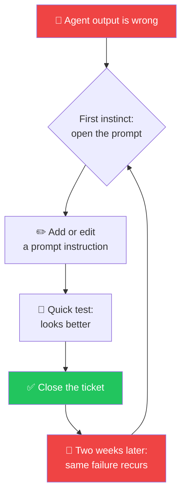

The first thing we did when our invoice extraction agent started returning wrong totals was open the prompt.

Natural instinct. Three engineers, same file, adding and removing sentences. "Be more precise about line item totals." "When a table spans multiple pages, combine the values." "Always return monetary values as numbers, not strings." We deployed it. Checked the next few outputs. Looked better. Closed the ticket.

Two weeks later, same problem.

The prompt was never the issue.

## The Real Cause Was Two Steps Back

After the second incident, we actually dug in. The problem wasn't in the agent's instructions. It was in the PDF parsing step that ran before the agent saw any data.

Some invoices from one specific vendor format their tables with merged cells. Our parser was silently dropping merged row values and passing the agent a table that looked complete but had missing rows. The agent did exactly what its prompt said. It just received wrong input.

We had changed the prompt twice to compensate for behavior that wasn't the agent's fault. Both changes are still in there. Neither one does anything useful.

## Why This Pattern Keeps Happening

Prompts are the easiest thing to change. No deployment pipeline, no code review in some teams. You open a field, add a sentence, save. It feels like a fix.

Input validation, tool configurations, trigger conditions, output schemas — those all require more work. So when something goes wrong, the prompt gets the first attempt. Often the second and third attempts too. Sometimes teams solve the wrong problem and never notice, because the failure rate drops enough to quiet the complaints.

Here's what that loop looks like in practice:

The loop can run for months on a problem that lives in the data pipeline, the tool call, or the task trigger — not in the agent instructions at all.

## Five Things to Check Before You Touch the Prompt

When an AI agent produces wrong output, work through these first:

**1. What did the agent actually receive?**

Log the full input the agent sees, not the raw source data. If you're not logging this, you don't know what the agent is working with. Malformed data, truncated context, missing fields — all of these produce behavior that looks like a prompt failure until you see the actual input payload.

**2. Did the tools return what you expected?**

If the agent uses external tools — search, retrieval, APIs — check what those tools returned on the failing task. A search tool returning cached results, a retrieval step pulling from a stale index, an API returning a different response format than expected. These all surface as "wrong outputs" from the agent's perspective, but the agent is responding correctly to what it received.

**3. Was the task description clear?**

Not the system prompt. The task itself. "Summarize this document" and "extract the key decision points from this document" produce very different outputs. Vague task descriptions produce inconsistent results that feel like model failures. The fix is in how you write the task, not in the agent's standing instructions.

**4. Did the output parser handle the edge case?**

A structured output that doesn't match your expected schema often gets surfaced as "the agent gave the wrong answer." Sometimes the agent gave a correct answer in an unexpected format. Your parser dropped it or defaulted to empty. That shows up in monitoring as a failure with no obvious cause.

**5. Was this the same input type as before?**

Agents that work well on one class of input often fail on a different class without any warning. If invoices from a new vendor started arriving, or a data source changed format, that's an input population change. Not a prompt problem. [Agent monitoring](/features/agent-monitoring) that tracks task types separately makes this much easier to spot.

## What the Prompt Can Actually Fix

None of this means prompts don't matter. They do.

Prompts fix agent reasoning: how it weighs conflicting information, how it handles ambiguous inputs, what it prioritizes when two instructions pull in different directions. If you've worked through the five checks above and the agent is still making judgment errors on clean, well-formed input, that's a prompt problem. Go fix it.

The goal is to not start there by default. Prompt changes are fast, but they accumulate. Teams that treat the prompt as a general-purpose fix end up with 80-line instructions that compensate for problems that may have been fixed at the source months ago. Nobody knows which lines are still load-bearing.

The other issue with reflexive prompt changes: they can mask upstream problems that are getting worse. You tune the prompt for the current failure rate. The upstream problem continues. You tune again. Eventually the prompt is too fragile to tune further and the upstream problem is worse than when you started.

## Who This Matters Most For

Teams managing fewer than 10 agents hit this the hardest, because small fleets don't have enough incident volume to establish patterns. Each failure feels like a one-off. The prompt change "works" often enough that the real cause never gets traced.

It also shows up when one person is responsible for all agent configurations. No second opinion, no forcing function to think through the full stack. The fastest path — open the prompt — becomes the only path. A few months of that and your prompts are carrying instructions written to compensate for problems you've since fixed, or problems you never actually had.

You can see the full picture in [AgentCenter's agent dashboard](/features/agent-dashboard) — input, tool calls, output, and task context in one view. When you can see all of it, the diagnosis takes minutes instead of hours. You stop guessing which layer the failure lives in.

## The Honest Caveat

Sometimes it really is the prompt. Poorly structured instructions produce inconsistent outputs. Ambiguous phrasing creates model decisions you didn't intend. A prompt written for 10 tasks a day can behave differently under 1,000 tasks a day when context pressure changes what the model attends to.

But prompt failures tend to look consistent. The same type of input fails the same way, reliably. Data failures and tool failures are messier — they appear and disappear as the input population changes.

If your failures don't cluster consistently across input types, start with the data. The prompt probably had nothing to do with it.

---

*The dashboard won't fix a broken agent. But it will tell you which one is broken at 3am. [Try AgentCenter free](/pricing).*
