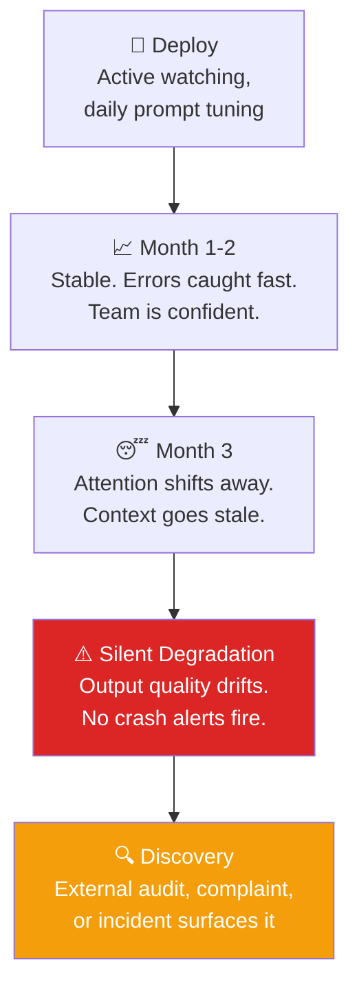

The first few weeks after you deploy an agent, you're watching it closely. You're reading outputs, adjusting prompts, checking the monitoring dashboard twice a day. If something breaks, you catch it fast.

By the end of month two, you're satisfied. The error rate looks good. The outputs seem reasonable. You've moved on to other work.

That's when things start going wrong.

## The 90-Day Production Blind Spot

Month three is the hardest phase for most production agents. Not because the model gets worse or because something dramatic breaks. Because the attention falls away before the habits form.

The engineer who built the agent is now on a new project. The prompts haven't been reviewed since the initial tuning cycle. The context sources the agent pulls from haven't been refreshed in six weeks. The monitoring dashboard is still running, but nobody's opening it.

This isn't negligence. It's what "stable" looks like from the outside when nothing has crashed.

## What Actually Goes Wrong

Here's what the third month tends to look like in practice.

**Context drift.** Your agent was set up with product documentation, internal knowledge, or API specs from deployment day. By month three, things have changed. New features shipped. Pricing updated. A workflow got restructured. The agent doesn't know. It keeps answering confidently using stale information, and the answers look fine because they're formatted properly.

One team running a customer-facing agent went six weeks without noticing it was quoting an old feature set to users. The error rate was zero. The agent wasn't failing. It was just wrong.

**Prompt tech debt.** Early on, you made quick tweaks to improve performance. Add this instruction. Remove that clause. By month three, the prompt has 12 incremental edits nobody has read end-to-end since week two. Some of those changes interact in ways that weren't planned.

**Metric drift.** The alerts you configured in month one were calibrated to the agent you had in month one. Then a product update added three new task types. The agent didn't handle them well. The original metrics didn't catch this because they weren't measuring for it. Output quality dropped 18 points, but the dashboard still showed green.

Here's what this pattern looks like over time:

Most teams first learn about month-three drift at the last node. Something external forces the audit: a user complaint, a quarterly review, an incident that finally breaks the surface.

## What to Do About It

The fix isn't complicated. It just needs to be planned at deployment time, not discovered after the fact.

**Set a 90-day review as part of your deployment checklist.** Not a calendar reminder you'll skip. An assigned task, just like you'd schedule a code review. The review takes two hours: re-read the full prompt, check every context source for freshness, manually read through 30 recent outputs, and update your alert thresholds.

**Track output quality, not just crashes.** Crash rates tell you the agent is running. They don't tell you the agent is useful. Pick two or three quality signals specific to what your agent does. A summary agent needs a coherence check. A classification agent needs accuracy against a sample set. Set alerts on those, not just on error counts. AgentCenter's [agent monitoring](/features/agent-monitoring) lets you track these signals per agent, so drift shows up before it becomes a customer complaint.

**Make context sources explicit.** Know exactly what data your agent is using and when it was last updated. If you're pulling from documentation, set a review date. If you're relying on internal specs, version them. When context goes stale, you want to know because you planned for it, not because a user reports it.

**Read the full prompt every 60 days.** Not skim it. Read it. You'll catch things that accumulated from quick edits and no longer make sense together.

You can also use [task orchestration in AgentCenter](/features/task-orchestration) to assign recurring maintenance tasks to a human reviewer, so the 90-day check actually gets done rather than sitting in someone's backlog.

## Who This Matters Most For

If you're running 3 to 10 agents and at least one has been in production for more than 8 weeks, this is your situation. You're past the deployment scramble. You're not yet at the scale where you've built formal agent ops processes. You're in the quiet middle period where things look stable but haven't been verified to still be stable.

The teams I've seen handle this well treat month three like a second launch. They don't assume the deployment held up. They check.

## The Honest Caveat

This problem isn't unique to AI agents. Any automated system degrades when nobody reviews it. What makes agents different is how the failure looks.

A broken API returns an error code. A degraded agent returns something that looks right. It's formatted correctly, it's grammatically fine, it answers the question you asked. The failure is in the content, not the form. That's much harder to catch without deliberate review.

A dashboard alone won't fix this. The habit of reviewing is what fixes it.

---

*The dashboard won't fix a broken agent. But it will tell you which one is broken at 3am. [Try AgentCenter free](/pricing).*
