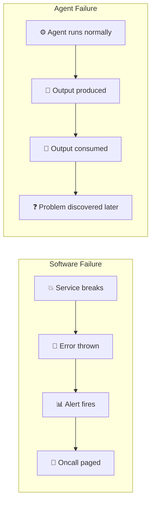

The first time we had a serious agent incident, we opened our incident runbook.

It had the right structure. A place to log the start time. Steps to identify the failing service. Commands to pull error logs. A field for severity. A field for affected users. An escalation path. We'd used it for software failures a hundred times.

We got about three steps in before it stopped making sense.

The agent hadn't crashed. There was no error in the logs. No stack trace, no failed health check, no alert from our monitoring service. The agent was running. It was completing tasks. It was just producing reports that were subtly, systematically wrong. For four days.

That's when we realized our runbook was written for a different kind of failure entirely.

## What Software Runbooks Assume

Software incident runbooks are built on a reliable premise: when something breaks, it signals. The service throws an exception. The health check fails. The error rate spikes. Response time climbs. Something observable changes in a way that triggers an alert.

The runbook starts from that trigger. First step is usually: "Identify the failing component." That's possible because the component is announcing its failure.

AI agent failures don't work this way.

When an agent fails, it still runs. It still produces something. That output gets sent wherever it was supposed to go. The downstream system doesn't know it's wrong. The agent doesn't know it's wrong. Your monitoring dashboard shows green.

The failure is semantic, not systemic.

## The Start Time Problem

One of the first questions in any incident runbook: when did this start?

For software failures, that's usually answerable within a minute. Check the error logs, look at the timestamp on the first exception, correlate with your deployment history.

For agent failures, that question is genuinely hard. The agent we had problems with had been producing subtly wrong reports for four days before anyone noticed. We could have been wrong for two days. Or six. We weren't sure. The reports didn't include a "this is wrong" indicator, so there was no moment we could point to.

This matters because it changes the scope of the incident. If your agent was wrong for four days, every output in those four days is potentially compromised. That's a review and remediation project, not a point-in-time fix. Software runbooks don't have a section for "figure out how far back the contamination goes."

## The Blast Radius Is Invisible

When a software service goes down, you can bound the blast radius quickly. Which endpoints were affected? Which user requests failed? You have logs, error counts, a time window.

Agent failures spread silently. The report went to five stakeholders who made decisions based on it. The analysis got fed into a downstream agent that used it as context. The summary got posted in Slack and read by eight people. None of this created an error log.

The blast radius of a semantic failure is measured in decisions made, not requests failed. That's much harder to quantify, and it means the "impact assessment" section of your runbook is unanswerable with the tools you're used to using.

## Rolling Back Doesn't Undo Outputs

Software incidents have a reliable escape hatch: rollback. Deploy the previous version, restore the database, revert the config change. The system returns to the prior state.

There's no rollback for agent outputs that were already consumed.

You can roll back the agent's prompt. You can revert to an older model version. You can re-run the tasks with the corrected configuration. But the outputs that went out before you caught the problem are already in the world. They've been read. They've been acted on. They may have been used as inputs to other processes.

This isn't an argument against rollback. [Rollback is still one of the most valuable tools you have for AI agents](/features/agent-monitoring). But it solves a different problem than it does in software. It stops the bleeding. It doesn't reverse it.

Your incident runbook probably has a rollback step that implies "problem solved." For agent incidents, rolling back means the problem is stopped, not resolved. The remediation work (figuring out what outputs were affected and what to do about them) comes after.

## The Fix Is Ambiguous

For most software bugs, you can trace the failure to a line of code. You find the root cause, you fix it, you test it, you deploy. The path from "identified problem" to "root cause" to "fix" is reasonably clear.

For agent failures, the root cause could be a prompt that stopped working when the model updated, an input that arrived in an unexpected format, a dependency that changed silently, or a combination of conditions that only occurs at production scale.

And you usually can't reproduce it in staging. The exact state (the specific inputs, the conversation history, the model's sampling decisions) isn't replayable the way a software request is.

Your runbook has a "root cause identified" checkbox. For agent incidents, that checkbox often gets replaced by "most likely cause, confidence moderate."

## What Actually Helps

None of this means agent incidents are unmanageable. But managing them well requires a different set of habits than software incident response.

The teams that handle agent failures well tend to do a few specific things:

**They build detection before they need it.** The hardest part of our four-day failure wasn't the response; it was that we had no detection. We needed someone to notice something felt off. Teams that do better have [output sampling and scoring in place before anything goes wrong](/features/agent-monitoring), so anomalies surface before they compound.

**They define "wrong" in advance.** What does a bad report look like? What would make you flag a task output for human review? These questions are much easier to answer before an incident than during one. The answers become your detection criteria.

**They scope outputs, not services.** The question in a software incident is "which services are affected?" The question in an agent incident is "which outputs need to be reviewed?" Different tooling, different thinking.

**They audit before they rollback.** When the fix is "roll back the prompt," the first move is to understand which tasks ran under the bad configuration. That audit is the work. The rollback is the last step, not the first.

## Who This Matters Most For

If you're running more than 5 agents in production and you've never had an incident, you've either been lucky or haven't looked closely enough.

This matters most for teams who've scaled beyond what one person can track. At 3 agents, you probably know if something is off. At 15, you can't. And at 15, you're probably still using the incident process you built for software services.

The gap between "agent incident happened" and "we understand what we're dealing with" is where most teams lose time. Not because they're slow, but because the process doesn't fit the problem.

## The Honest Caveat

Building a proper agent incident response process takes time. You need output monitoring, sampling, and some way to scope the blast radius of a semantic failure. Most teams don't have all of that on day one.

But recognizing that your existing runbook doesn't apply is the necessary first step. Trying to fit an agent incident into a software incident template burns time and creates false confidence that you've understood the problem when you've only understood a part of it.

---

*The dashboard won't fix a broken agent. But it will tell you which one is broken at 3am. [Try AgentCenter free](/pricing).*
