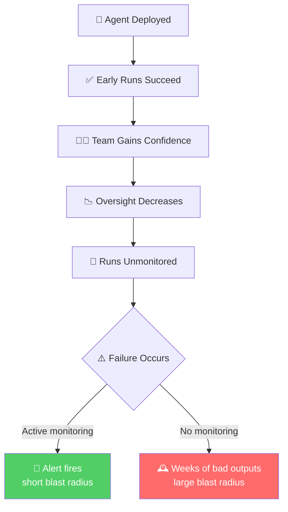

We had an agent running every Monday morning for four months. Financial summary reports, pulled from three internal sources, formatted and delivered to the ops team by 8am. It never failed. Not once.

By month three, nobody was reviewing its outputs. The team had moved on to harder problems: a new content pipeline, an escalating support queue, a multi-agent workflow that kept deadlocking.

In week 18, one of those data sources changed its date format. The agent kept running. It kept succeeding. And for three weeks, the summary reports contained transposed quarter-over-quarter figures that made revenue look slightly better than it was.

Nobody noticed until a board meeting.

## The Trust Trap

This is the pattern that catches most teams eventually. An agent earns trust by performing reliably. Reliability reduces the perceived need for oversight. Reduced oversight means the next failure runs longer before anyone sees it.

It's not irrational. You have limited attention. Watching an agent that has never failed in 100 runs feels like wasted effort. That attention goes to the agent that's throwing errors three times a week.

But here's what that logic gets wrong: the error-prone agent is already on your radar. You're watching it. When it breaks, you know quickly. When the quiet reliable agent breaks, you have no idea. It might be days or weeks before the damage surfaces.

## Why Reliable Agents Fail in Bigger Ways

Reliable agents tend to get assigned to more important tasks. You build confidence in them, you trust them with more sensitive data, higher-stakes outputs, more downstream dependencies. The Monday summary agent didn't matter when it was delivering reports nobody read. It mattered a lot by the time it was feeding the exec dashboard.

There's also a compounding effect from skipping review. An agent that gets reviewed every few runs gets corrected when it drifts. An agent that hasn't been reviewed in 30 days can drift a long way before anyone notices.

Three failure patterns we've seen across teams:

**The silent format mismatch.** A third-party API changes its response structure. The agent parses the new structure incorrectly and produces plausible-looking but wrong output. No error. No alert. Just wrong data that looks right.

**The scope creep failure.** An email dispatch agent was originally scoped to send 50 messages per run. Over time, the task volume grew. Nobody updated the rate limits. One week it sent 400 emails before the team noticed.

**The dependency assumption.** A report-generation agent was built against a specific version of an internal database schema. The schema changed. The agent kept running successfully. It was just querying the wrong columns. Outputs were superficially correct for weeks.

None of these failures produced error logs. All three came from reliable agents nobody was watching closely.

## What to Track Instead of Error Rate

Error rate is easy to measure. It's also the wrong primary metric for a reliable agent.

What you actually want to know:

- **Output variance.** Is the agent producing outputs that look meaningfully different from last week? A sudden change in output length, structure, or format is often the first sign something changed upstream.
- **Last human review date.** If nobody has looked at this agent's output in 30 days, that's a risk signal regardless of how many successful runs it's had.
- **Dependency health.** Are the data sources and APIs this agent relies on behaving the same way they were when you built it? External changes don't show up in your agent's error logs.
- **Impact scope.** How many downstream things depend on this agent's outputs? A reliable agent with five downstream consumers is more dangerous when it fails than a flaky agent nobody depends on.

You can track all of this in [AgentCenter's agent monitoring dashboard](/features/agent-monitoring). The point isn't to add manual review to everything. It's to set proportional check-in cadences based on impact, not based on past performance.

## The Frame Worth Keeping

Think of oversight as a function of impact, not reliability.

An agent that handles low-stakes tasks and has never failed probably doesn't need daily review. An agent that feeds executive dashboards, triggers financial processes, or sends external communications needs regular review even if it's never thrown an error.

The question to ask about every agent you run: if this produces wrong output for two weeks before anyone notices, what breaks? If the answer is "something important," it needs more oversight than you're probably giving it right now.

## Who This Matters Most For

This matters most for teams that have crossed the initial hurdle. You've deployed agents, they're running reliably, you're moving on to building new ones. That phase, where confidence is high and attention is scarce, is exactly when the quiet failures start accumulating.

Solo technical founders are particularly exposed. With no team to review outputs, a reliable agent can run wrong for a long time before the founder notices.

## The Honest Caveat

None of this is an argument against automation. If you're manually reviewing every agent output every day, you've undone the value of having agents at all. The goal is proportional oversight: light touch on low-stakes reliable agents, meaningful check-ins on high-impact ones.

The mistake isn't trusting your agents. The mistake is treating "has never failed" as a reason to stop checking.

---

*The dashboard won't fix a broken agent. But it will tell you which one is broken at 3am. [Try AgentCenter free](/pricing).*
