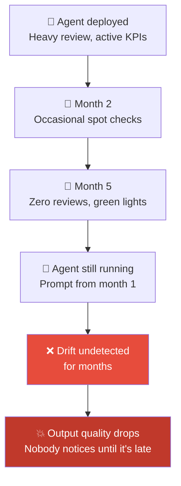

Six months after deploying our research agent, we stopped reviewing its outputs entirely. Not because we decided to. We just stopped. The agent ran every morning, the queue stayed clear, nobody filed a complaint. Green lights everywhere.

Then a new team member did something nobody else had done in four months: they actually read the outputs.

That agent had been producing summaries based on a prompt written before we repositioned the product. It flagged competitor features we no longer cared about. It missed the angles that now mattered most. Eight months of noise that looked like signal.

Nobody caught it because nobody looked.

## The trust problem with long-running agents

When you deploy a new agent, everyone pays attention. The first 20 outputs get scrutinized. The team debates edge cases. Someone books a review session.

Then six months pass. The agent runs clean. No errors. No complaints. The review sessions quietly disappear.

This is how your most-used agents become your least-understood ones.

The agents that have run longest are the ones with the most accumulated drift. Their prompts were written for a product version that no longer exists. Their success criteria reflect goals from six months ago. The edge cases they handle in production are undocumented.

But they show green. So the team assumes they're fine.

## Three patterns that make this worse

**Scrutiny clusters at launch.** Teams build intensive review processes for new agents and almost nothing for agents in month six. The agent that needed scrutiny at launch still needs it. The review habit just dissolved.

**Familiarity substitutes for understanding.** "We've been running this for eight months" is not the same as "we understand what it's producing." Long tenure reads as reliability. It isn't. It's just longevity.

**Success metrics stop being asked.** New agents get KPIs. Existing agents get ignored. The original question, "is this agent delivering value?", stops getting asked. The agent just keeps running because nobody explicitly stopped it.

## What you actually find when you look

We picked our three longest-running agents and did something simple: read 30 outputs from each one cold. No filters, no dashboard view. Just the raw outputs.

All three had issues.

One agent was using a tone we'd removed from our content guidelines four months earlier. Another referenced a product feature we'd renamed. The third had drifted from what the team needed. It answered the original question, not the current one.

None of this showed up as errors. The agents were "working." They just weren't doing useful work anymore.

That distinction matters. An agent that crashes is visible. An agent that quietly produces outputs nobody uses is invisible until something downstream breaks.

## Why the high-use agents are highest risk

Here's the counterintuitive part: the more an agent runs, the more it matters, and the more it matters, the worse it is to discover a silent failure six months in.

A new agent with a problem costs you a week of bad outputs before someone catches it. A two-year-old agent with a problem has been degrading for months, quietly compounding. Every workflow that depends on its output has been building on a foundation you didn't know was shifting.

The risk scales with tenure, not with novelty.

## The review habit that actually fixes this

Schedule output reviews for your most-used agents first, not your newest ones.

This feels backwards. New agents feel risky. Old agents feel safe. But the risk isn't novelty. It's drift, and drift accumulates with time.

A few things that work:

**Monthly output spot-checks.** Pull 20 outputs at random and read them against your current success criteria. Not a metric report. Actual outputs. This takes about 20 minutes and catches most silent drift before it becomes an incident.

**Quarterly prompt review.** Treat the prompt like code. Has anything changed in the product, market, or workflow that the prompt doesn't reflect? If you can't answer that question without reading the prompt again, that's the sign.

**Owner rotation.** The person who built the agent shouldn't be the only one reviewing it. Someone who sees the outputs fresh will catch things the original author stops seeing.

In [AgentCenter's agent monitoring view](/features/agent-monitoring), you can track how long each agent has been running and pull recent output logs. The visibility is there. The review habit has to be deliberate.

## Who this hits hardest

Teams in their second year of agent deployment. You have 10 to 20 agents running, most from the first six months. Attention is on new agents, new workflows, new integrations.

The old reliable ones are invisible. That's the problem.

Engineers who built early agents and moved on to new projects. The agent keeps running. The original builder's mental model of it is 12 months stale. Nobody inherited the review responsibility.

Technical founders running a small fleet without dedicated ops. Every agent that "just works" is one less thing to think about. Which is exactly what makes it risky.

If you can't describe what your three longest-running agents are currently producing, start there. Not your newest ones. The ones that have been running so long you forgot to keep watching them.

## The honest caveat

[AgentCenter's dashboard](/features/agent-dashboard) shows you agent status, task completion, and cost. It tells you the agent ran. What it can't tell you is whether the outputs still match what your business actually needs. That check requires a human who knows what good looks like today, not six months ago.

The teams that get this right don't review agents more often. They review the right agents. The ones that have been running longest and received the least scrutiny are your highest risk.

Build the habit before the outputs tell you they had to.

---

*The dashboard won't fix a broken agent. But it will tell you which one is broken at 3am. [Try AgentCenter free](/pricing).*
