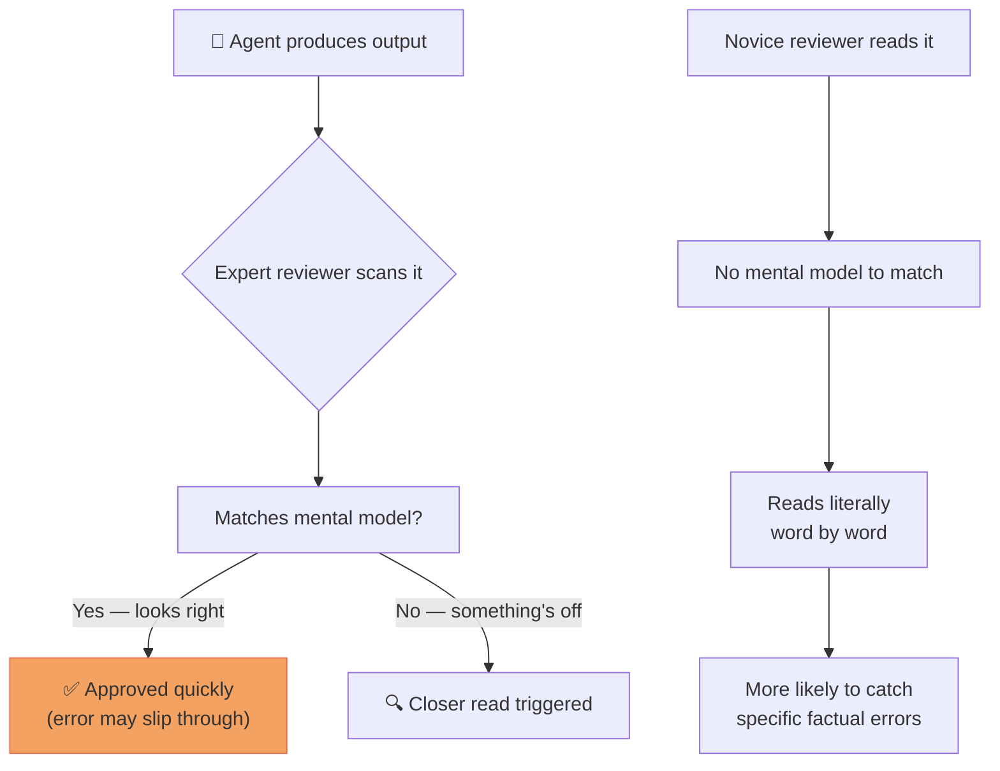

We had a compliance agent reviewing vendor contracts. Every Thursday, our lead counsel spent about forty minutes going through its outputs. She'd been doing contracts for eleven years. We trusted her review completely.

Three months in, a junior analyst on her team flagged something odd. The agent had been misclassifying indemnification clauses — not always, maybe one in eight — in a way that looked right if you already knew what to expect. Our lead counsel had been reading what she expected to see. The junior analyst, who had to look everything up, was reading what was actually there.

## The Expert's Blind Spot

This isn't a story about incompetence. It's about how expertise works.

When you know a domain deeply, your brain stops reading and starts pattern-matching. You've seen the structure a thousand times. So you scan for the pieces that matter — and your brain fills in the rest. This is exactly why experienced readers are terrible proofreaders of their own work, and why senior engineers reviewing AI output miss errors that junior engineers catch.

The agent outputs that look most plausible to an expert are also the outputs most likely to contain subtle, specific errors. Not broken logic or garbled text — those are easy to catch. The hard failures are the outputs that are 90% right. They use the right vocabulary, follow the expected structure, and hit the same beats the expert is looking for. The expert's brain autocompletes the gap.

## Three Ways Expertise Breaks Review

**Speed.** Experts review faster. That's usually a feature. But speed plus familiarity means less scrutiny per line. An expert who reviews 40 outputs in an hour is doing something fundamentally different from a junior reviewer who takes three minutes per output. The junior's slower pace catches more.

**Confirmation bias.** When agent output aligns with your expectations, you spend less time on it. An expert who expects the agent to handle standard cases correctly will spend their attention on the edge cases — even when the standard cases are where the errors are hiding.

**Vocabulary matching.** Agents trained on domain-specific text learn the vocabulary. They use the right terms. To a domain expert, correct vocabulary signals correct reasoning. But it doesn't. An agent can use all the right words and still reach the wrong conclusion, apply the wrong rule, or miss a critical condition.

## What This Means for Your Review Process

The instinct is to route important agent outputs to your most experienced people. That's right in some ways — you need domain expertise to catch substantive errors. But it's wrong if your experts are doing unchecked, speed-optimized reviews.

A few things that actually help:

**Structured checklists force literal reading.** A checklist that says "verify the indemnification clause classifies as X, Y, or Z" makes the expert stop and check the specific claim, not pattern-match against the overall shape of the output. [AgentCenter's deliverable review workflow](/features/agent-monitoring) lets you attach review criteria to task types — so reviewers see a checklist, not just a text box.

**Rotate who reviews what.** If the same expert reviews the same agent every week, familiarity compounds. Rotating reviewers — even within a team — breaks the pattern and surfaces errors that routine had hidden.

**Sample junior reviewer alongside expert.** Not instead of — alongside. A 10% sample of outputs reviewed by someone without domain expertise will catch a different class of errors. What they can't evaluate substantively, they can still flag as "this doesn't look right" — which is often enough.

**Watch for output variance, not just output quality.** Drift in an agent's outputs — even when individual outputs still pass review — often signals a problem before any single output fails clearly enough to flag. [Agent monitoring](/features/agent-monitoring) that tracks output patterns over time catches this; a human reviewer checking one output at a time doesn't.

## Who This Matters Most For

Teams where technical leads and senior engineers are doing the bulk of agent output review. This is common in the early stages of deployment, when there isn't enough infrastructure around review and the natural move is to ask the most qualified person on the team.

It's also common on teams where agent outputs feed into high-stakes decisions — legal, compliance, financial. The higher the stakes, the more you want your expert reviewing. Which is exactly when expertise-driven blind spots do the most damage.

## The Honest Caveat

None of this means you should pull your senior people out of the review process. You need domain expertise to catch real errors — the ones that require judgment, not just careful reading. The problem is an unchecked assumption: that expertise equals quality review. It doesn't. It equals a particular *kind* of review, with particular strengths and particular blind spots.

The teams that catch the most agent errors aren't the ones with the best reviewers. They're the ones who built a review process that doesn't rely entirely on any single reviewer's judgment.

---

*The dashboard won't fix a broken agent. But it will tell you which one is broken at 3am. [Try AgentCenter free](/pricing).*
